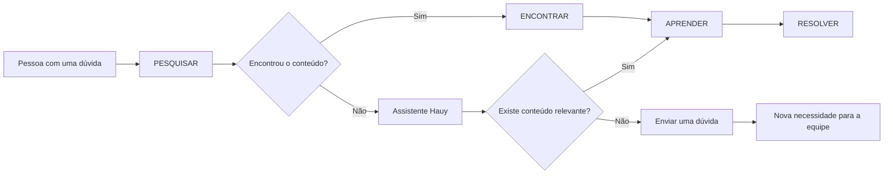
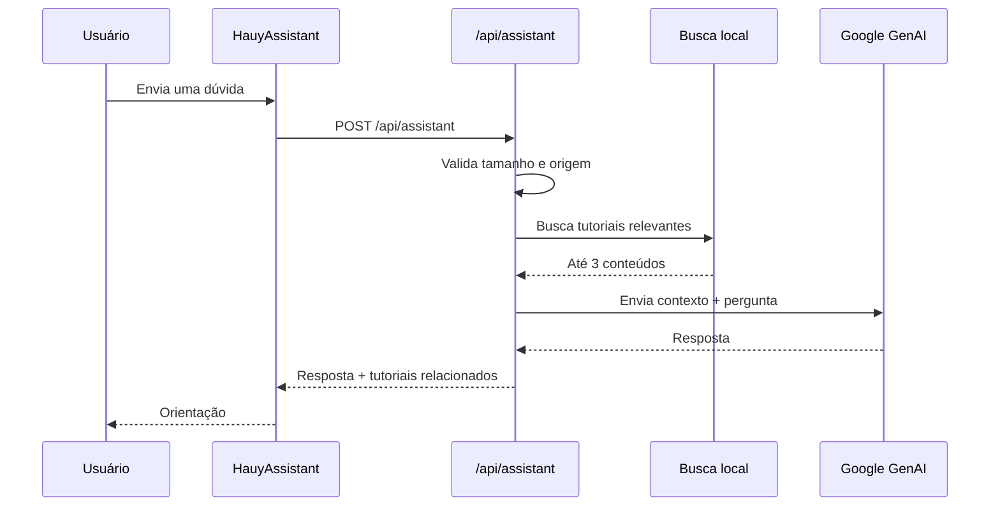

# Hauy Conecta

<p align="center">
  <a href="https://hauy-conecta.vercel.app/" target="_blank">
    
  </a>
</p>

<p align="center">
  <a href="https://hauy-conecta.vercel.app/" target="_blank">
    
  </a>
</p>

<p align="center">
  <strong>Portal educacional digital criado para transformar dúvidas tecnológicas do cotidiano escolar em orientações claras, acessíveis e práticas.</strong>
</p>

<p align="center">
  <a href="https://hauy-conecta.vercel.app/" target="_blank">🌐 Site</a>
  &nbsp;•&nbsp;
  <a href="https://hauy-conecta.vercel.app/tutoriais" target="_blank">📚 Tutoriais</a>
  &nbsp;•&nbsp;
  <a href="https://hauy-conecta.vercel.app/categorias" target="_blank">🗂️ Categorias</a>
  &nbsp;•&nbsp;
  <a href="https://hauy-conecta.vercel.app/assistente-hauy" target="_blank">🤖 Assistente</a>
  &nbsp;•&nbsp;
  <a href="https://hauy-conecta.vercel.app/faq" target="_blank">❓ FAQ</a>
</p>

<p align="center">
  <a href="https://github.com/kleber-goncalves/helpe-center/actions/workflows/prerender.yml" target="_blank">
    
  </a>
  <a href="https://vite.dev/" target="_blank">
    
  </a>
  <a href="https://react.dev/" target="_blank">
    
  </a>
  <a href="https://tailwindcss.com/" target="_blank">
    
  </a>
  <a href="https://vercel.com/" target="_blank">
    
  </a>
</p>

---

## Navegação

- [Visão geral](#visão-geral)
- [O problema](#o-problema)
- [Objetivo do projeto](#objetivo-do-projeto)
- [Como a solução funciona](#como-a-solução-funciona)
- [Principais recursos](#principais-recursos)
- [Arquitetura de informação](#arquitetura-de-informação)
- [Tecnologias](#tecnologias)
- [Arquitetura técnica](#arquitetura-técnica)
- [SEO e pré-renderização](#seo-e-pré-renderização)
- [Acessibilidade](#acessibilidade)
- [PWA e uso offline](#pwa-e-uso-offline)
- [Assistente Hauy](#assistente-hauy)
- [Conteúdo e dados](#conteúdo-e-dados)
- [Privacidade e segurança](#privacidade-e-segurança)
- [Governança e segurança](#governança-e-segurança)
- [Estrutura do projeto](#estrutura-do-projeto)
- [Como executar localmente](#como-executar-localmente)
- [Variáveis de ambiente](#variáveis-de-ambiente)
- [Scripts disponíveis](#scripts-disponíveis)
- [Build e deploy](#build-e-deploy)
- [Rotas](#rotas)
- [Equipe](#equipe)
- [Direções de evolução](#direções-de-evolução)
- [Licença e contexto](#licença-e-contexto)

---

## Visão geral

**Hauy Conecta** é a **Central de Ajuda Digital da Escola Estadual Hauy Petrucely Mairync**.

O projeto nasceu dentro de uma iniciativa escolar de inclusão e suporte tecnológico. A ideia central é simples: estudantes, professores e funcionários convivem diariamente com ferramentas digitais, mas nem sempre encontram uma orientação rápida, didática e adequada ao nível de conhecimento de quem está começando.

Em vez de depender de explicações espalhadas em diferentes lugares, o portal reúne:

- tutoriais passo a passo;
- organização por categorias;
- busca de conteúdo;
- perguntas frequentes;
- canal para enviar novas dúvidas;
- um assistente digital que consulta o conteúdo existente da Central;
- recursos de acessibilidade;
- páginas pré-renderizadas para melhorar a entrega de conteúdo e metadados.

O projeto foi concebido para que a tecnologia **reduza a barreira**, e não para que o usuário precise dominar tecnologia antes de conseguir ajuda.

> **Princípio do produto:** transformar uma dúvida real em um caminho curto entre **PESQUISAR → ENCONTRAR → APRENDER → RESOLVER**.

---

## O problema

No contexto escolar, muitas tarefas digitais são simples para quem já possui familiaridade com informática, mas podem representar uma barreira para quem ainda está aprendendo.

Entre as necessidades levantadas pelo projeto estão situações como:

- formatar trabalhos no Word;
- criar um sumário automático;
- começar a usar o Excel;
- imprimir e digitalizar documentos;
- compartilhar arquivos;
- salvar arquivos no Google Drive;
- converter documentos para PDF;
- anexar arquivos em e-mails;
- criar apresentações no Canva;
- utilizar plataformas digitais da escola.

Como parte da etapa de diagnóstico, uma pesquisa reuniu **19 respostas**. Os resultados foram usados de forma agregada para orientar as prioridades iniciais dos tutoriais, sem expor respostas individuais ou dados identificáveis.

### Prioridades de conteúdo

| Prioridade          | Assuntos                                                                                                                    |
| ------------------- | --------------------------------------------------------------------------------------------------------------------------- |
| Maior prioridade    | Excel, formatação de trabalhos, impressão, digitalização, compartilhamento de arquivos, sumário automático e Canva          |
| Também importantes  | PDF, e-mail, plataformas da escola, acesso a contas e Google Drive                                                          |
| Outras necessidades | PowerPoint, LibreOffice, digitação, informática básica, Data Show, edição de imagens e vídeos, banco de dados e programação |

O objetivo não é criar uma enorme biblioteca de tecnologia.

O objetivo é **resolver primeiro aquilo que realmente aparece no dia a dia da comunidade escolar**.

---

## Objetivo do projeto

O Hauy Conecta busca:

1. **Facilitar o acesso ao conhecimento digital** para quem está começando.
2. **Reduzir a dependência de ajuda presencial** em tarefas recorrentes.
3. **Organizar conteúdos por ferramenta e necessidade**, tornando a procura mais rápida.
4. **Ensinar por etapas**, utilizando instruções curtas e exemplos visuais.
5. **Criar um canal contínuo de melhoria**, permitindo o envio de novas dúvidas.
6. **Usar acessibilidade como parte da experiência**, e não como recurso secundário.
7. **Preservar a privacidade**, trabalhando com informações agregadas quando a pesquisa é utilizada como base de decisão.

---

## Como a solução funciona



A experiência é organizada em torno de uma sequência simples:

### PESQUISAR

O usuário começa pela busca, pelas categorias ou pela lista de tutoriais.

### ENCONTRAR

O sistema apresenta conteúdos relacionados à ferramenta ou à tarefa procurada.

### APRENDER

Cada tutorial quebra a tarefa em etapas menores, combinando texto, imagens e, quando necessário, vídeos.

### RESOLVER

Depois de seguir o passo a passo, o usuário consegue executar a tarefa com mais autonomia.

Quando não existe conteúdo suficiente, há dois caminhos complementares:

- consultar o **Assistente Hauy**;
- **enviar uma dúvida** para a equipe responsável pelo projeto.

---

## Principais recursos

### 📚 Biblioteca de tutoriais

Os tutoriais são organizados como conteúdo estruturado em <code>src/data/tutorials.js</code>.

Cada tutorial pode possuir:

- título;
- categoria;
- dificuldade;
- duração estimada;
- descrição;
- palavras-chave;
- objetivos de aprendizagem;
- etapas;
- exemplos;
- imagens;
- vídeos;
- dicas.

A navegação trabalha com uma etapa por vez, permitindo que a pessoa avance ou retorne entre os passos sem transformar a página em um bloco excessivamente longo de instruções.

### 🗂️ Categorias

As categorias atualmente organizadas no projeto são:

- Word;
- Excel;
- E-mail;
- Arquivos e PDF;
- Google Drive;
- Canva;
- Plataformas da Escola;
- Informática Básica.

As categorias são definidas de forma declarativa em <code>src/data/categories.js</code>.

### 🔎 Busca

A página de tutoriais possui busca integrada para localizar conteúdos por assunto.

A lógica de pesquisa é centralizada em:

<code>src/lib/searchTutorials.js</code>

O projeto também registra pesquisas que não encontram conteúdo para ajudar a identificar novas necessidades de conteúdo.

### 🤖 Assistente Hauy

O portal possui uma página dedicada ao assistente e também um widget global.

A função do assistente não é substituir a Central, mas **usar os conteúdos dela para orientar o usuário**.

Quando uma dúvida chega à API:

1. a mensagem é validada;
2. os conteúdos relevantes são localizados pela busca interna;
3. somente os tutoriais relacionados são usados como contexto;
4. o modelo gera uma resposta em português do Brasil;
5. os tutoriais relacionados podem ser apresentados junto da resposta.

Quando a Central não possui conteúdo relevante, o sistema não inventa um tutorial: ele informa que ainda não encontrou conteúdo suficiente.

### ❓ FAQ

A página <code>/faq</code> concentra perguntas recorrentes em um formato compacto e acessível.

### 📝 Enviar uma dúvida

A página <code>/enviar-duvida</code> direciona o usuário para o formulário utilizado pelo projeto para receber novas necessidades.

### ♿ Acessibilidade

O projeto oferece controles para:

- escala de fonte;
- alto contraste;
- preferência por menos movimento;
- suporte a <code>prefers-reduced-motion</code>.

As preferências são persistidas localmente e aplicadas na inicialização da aplicação.

### 🌓 Tema

O projeto suporta tema claro e escuro, com adaptação à preferência salva do usuário e à preferência do sistema.

---

## Arquitetura de informação

A estrutura pública da aplicação é intencionalmente simples:

```text
Hauy Conecta
├── Início
├── Categorias
│   └── Categoria específica
├── Tutoriais
│   └── Tutorial específico
├── FAQ
├── Sobre o projeto
├── Enviar uma dúvida
└── Assistente
```

Isso mantém a arquitetura de navegação alinhada ao objetivo educacional: **menos camadas, menos fricção e mais previsibilidade**.

---

## Tecnologias

### Front-end

| Tecnologia                                                               | Função                                            |
| ------------------------------------------------------------------------ | ------------------------------------------------- |
| [React](https://react.dev/)                                              | Construção da interface                           |
| [React Router](https://reactrouter.com/)                                 | Roteamento e navegação                            |
| [Vite](https://vite.dev/)                                                | Desenvolvimento e build                           |
| [Tailwind CSS](https://tailwindcss.com/)                                 | Estilização utilitária                            |
| [GSAP](https://gsap.com/)                                                | Animações e transições                            |
| [@gsap/react](https://gsap.com/resources/react-basics/)                  | Integração do GSAP com React                      |
| [Lucide React](https://lucide.dev/)                                      | Ícones                                            |
| [Radix UI](https://www.radix-ui.com/)                                    | Primitivas acessíveis de interface                |
| [@sketchyicons/react](https://www.npmjs.com/package/@sketchyicons/react) | Ícones ilustrativos usados em partes da interface |
| [@thesvg/react](https://www.npmjs.com/package/@thesvg/react)             | Elementos SVG usados nas transições visuais       |

### Dados, IA e validação

| Tecnologia                             | Função                                                        |
| -------------------------------------- | ------------------------------------------------------------- |
| [Google GenAI](https://ai.google.dev/) | Integração do Assistente Hauy com o modelo Gemini             |
| [Zod](https://zod.dev/)                | Schemas e validação do formulário no frontend e no backend   |
| Busca local de tutoriais               | Seleção de conteúdo relevante antes da resposta do assistente |

### Build e entrega

| Tecnologia                                                              | Função                                      |
| ----------------------------------------------------------------------- | ------------------------------------------- |
| [Playwright](https://playwright.dev/)                                   | Navegação automatizada durante o pré-render |
| [Astratra Prerender](https://www.npmjs.com/package/@astratra/prerender) | Geração das páginas HTML pré-renderizadas   |
| [Sharp](https://sharp.pixelplumbing.com/)                               | Processamento/conversão de imagens          |
| [GitHub Actions](https://docs.github.com/actions)                       | Automação de build e pré-render             |
| [Vercel](https://vercel.com/)                                           | Hospedagem e entrega do site                |

---

## Arquitetura técnica

A aplicação usa uma arquitetura client-side com páginas carregadas sob demanda.

```mermaid
flowchart TB
    U[Browser]

    U --> R[React Router]
    R --> H[Home]
    R --> C[Categorias]
    R --> T[Tutoriais]
    R --> F[FAQ]
    R --> S[Sobre]
    R --> Q[Enviar dúvida]
    R --> A[Assistente]

    C --> CD[src/data/categories.js]
    T --> TD[src/data/tutorials.js]

    A --> API[/api/assistant]
    API --> SEARCH[src/lib/searchTutorials.js]
    API --> GEMINI[Google GenAI / Gemini]

    subgraph Build
      PR[generate-prerender-routes.mjs]
      V[Vite build]
      P[Astratra + Playwright]
      D[dist/]
      PR --> V --> P --> D
    end

    D --> GH[GitHub]
    GH --> VC[Vercel]
    VC --> U
```

### Code splitting

As páginas principais são carregadas com <code>React.lazy()</code> e <code>Suspense</code>.

Isso permite que cada rota carregue seu módulo quando necessário, em vez de enviar todos os componentes de página no primeiro carregamento.

Exemplo conceitual:

```jsx
const Tutorials = lazy(() =>
    import("./pages/Tutorials").then((module) => ({
        default: module.Tutorials,
    })),
);
```

### Componentização

A aplicação separa:

- páginas;
- componentes reutilizáveis;
- componentes de interface;
- hooks;
- dados;
- utilitários;
- lógica de busca;
- lógica de SEO;
- integração do assistente.

Essa separação facilita a evolução do portal à medida que novos tutoriais e recursos são adicionados.

---

## SEO e pré-renderização

Um dos pontos técnicos centrais do projeto é a geração de **HTML pré-renderizado por rota**.

Em uma SPA tradicional, elementos como <code>&lt;title&gt;</code>, <code>description</code>, Open Graph e JSON-LD podem ser alterados somente depois que o JavaScript é executado no navegador.

Para o Hauy Conecta, cada rota pública relevante é pré-renderizada para que os metadados façam parte do HTML entregue diretamente.

### O pipeline

```text
src/data/categories.js
        +
src/data/tutorials.js
        ↓
generate-prerender-routes.mjs
        ↓
prerender-routes.json
        ↓
vite build
        ↓
Astratra + Playwright
        ↓
dist/
├── index.html
├── categorias/
│   ├── index.html
│   └── <categoria>/index.html
└── tutoriais/
    ├── index.html
    └── <tutorial>/index.html
```

A lista de rotas é gerada automaticamente a partir dos dados da aplicação.

Isso evita manter manualmente uma lista duplicada de URLs de conteúdo.

### Metadados por página

A biblioteca <code>src/lib/seo.js</code> centraliza operações para:

- <code>&lt;title&gt;</code>;
- meta description;
- Open Graph;
- Twitter Cards;
- canonical;
- JSON-LD.

As páginas usam essas funções para definir metadados específicos.

### Exemplo

Um tutorial pode gerar:

```html
<title>Como criar um sumário automático no Word | Hauy Conecta</title>
```

em vez de depender somente do título genérico definido no <code>index.html</code>.

---

## Acessibilidade

A acessibilidade foi tratada como uma camada transversal da aplicação.

### Preferência por menos movimento

O projeto considera:

```css
@media (prefers-reduced-motion: reduce);
```

e também possui uma preferência explícita salva pelo usuário.

As animações podem ser reduzidas ou desativadas para evitar movimento desnecessário.

### Escala de fonte

A aplicação mantém uma variável global:

<code>--accessibility-font-scale</code>

com escalas pré-definidas para diferentes necessidades de leitura.

### Alto contraste

O estado de contraste elevado aplica uma paleta alternativa por meio de:

```html
<html data-accessibility-contrast="high"></html>
```

### Foco visível

Botões, links, inputs e elementos interativos recebem estados de foco visíveis para navegação por teclado.

### Semântica

A interface utiliza elementos semânticos, <code>aria-label</code>, <code>aria-live</code>, <code>aria-controls</code>, <code>aria-current</code> e outros atributos quando necessários.

---

## PWA e uso offline

O Hauy Conecta também é um Progressive Web App (PWA). A instalação é oferecida pelo recurso nativo do navegador; o projeto não mantém um botão próprio de instalação na página inicial.

A experiência offline utiliza camadas independentes:

- **App shell:** arquivos essenciais são pré-armazenados pelo Workbox para permitir abertura e navegação básica após uma primeira visita online.
- **Imagens gerais:** imagens da mesma origem entram no cache runtime quando são solicitadas; a biblioteca inteira não é baixada antecipadamente.
- **Pacotes de tutoriais:** a pessoa escolhe salvar um tutorial. O pacote inclui imagens das etapas, exemplos e pôsteres locais.
- **Vídeos MP4:** são opcionais e desmarcados por padrão. Quando selecionados, são baixados sequencialmente para controlar o pico de memória e podem ser reproduzidos e percorridos offline.

O Cache Storage guarda as respostas e o IndexedDB mantém os metadados dos pacotes. A atualização do app shell não deve apagar os pacotes opt-in dos tutoriais. Os pacotes ficam associados ao armazenamento do navegador e da origem em que foram salvos; não há sincronização automática entre dispositivos.

O Assistente Hauy, o envio de dúvidas, o registro remoto de pesquisas, o YouTube e os provedores externos de ferramentas continuam dependendo de rede. A disponibilidade offline não significa que todos os serviços da plataforma funcionem sem conexão.

Documentação técnica: [arquitetura da PWA](docs/arquitetura-pwa-hauy-conecta.md), [módulo PWA](src/pwa/README.md) e [testes PWA](tests/pwa/README.md).

---

## Assistente Hauy

O Assistente Hauy possui uma camada própria em:

```text
src/components/HauyAssistant.jsx
src/lib/assistant.js
api/assistant.js
```

### Fluxo da pergunta



### Limites implementados

A API aplica limites antes da chamada ao modelo:

- corpo máximo de **10.000 bytes**;
- mensagem máxima de **1.000 caracteres**;
- até **3 tutoriais relevantes** como contexto;
- limite de **20 solicitações por janela de 10 minutos por IP**;
- verificação básica da origem da requisição;
- respostas sem cache utilizando <code>Cache-Control: no-store</code>.

### Princípio de resposta

O prompt da aplicação orienta o assistente a:

- responder em português do Brasil;
- assumir que parte do público pode ser iniciante;
- usar os conteúdos recebidos como fonte principal;
- não inventar tutoriais;
- não inventar etapas ausentes do conteúdo;
- não solicitar informações pessoais para responder;
- indicar quando a Central ainda não possui conteúdo suficiente.

---

## Conteúdo e dados

O conteúdo educacional é mantido como dados estruturados, em vez de ficar disperso dentro de componentes de interface.

### Categorias

Arquivo:

<code>src/data/categories.js</code>

Responsável por armazenar:

- identificador;
- nome;
- descrição;
- ícone;
- temas prioritários.

### Tutoriais

Arquivo:

<code>src/data/tutorials.js</code>

Responsável por armazenar o conteúdo passo a passo.

A estrutura permite representar recursos como:

```js
{
    id: "exemplo",
    title: "Título do tutorial",
    category: "word",
    difficulty: "Fácil",
    duration: "5 minutos",
    description: "Descrição",
    keywords: [],
    learning: [],
    steps: [
        {
            title: "Primeiro passo",
            description: "Explicação",
            examples: [],
            tip: "Dica"
        }
    ]
}
```

Isso permite que a interface, a busca e o Assistente Hauy utilizem a mesma fonte de conteúdo.

---

## Privacidade e segurança

A proposta do portal é educacional e não exige cadastro de usuários para acessar os conteúdos.

### Pesquisa escolar

Os resultados da pesquisa usada no projeto servem como referência para priorização de conteúdo.

O portal **não exibe respostas individuais, nomes ou e-mails dos participantes**.

### Assistente

A chave do Gemini é mantida no ambiente do servidor por meio de variável de ambiente:

<code>GEMINI_API_KEY</code>

Ela não deve ser colocada diretamente no código do front-end.

### Proteções da API

A função <code>/api/assistant</code> implementa validações de:

- tamanho do body;
- formato JSON;
- tamanho da mensagem;
- origem da requisição;
- frequência de solicitações;
- ausência de chave de API.

Também envia:

```http
Cache-Control: no-store
X-Content-Type-Options: nosniff
```

nas respostas JSON.

> **Importante:** as proteções atuais reduzem abuso e erros comuns, mas não substituem uma arquitetura de segurança completa para cenários de maior escala.


## Governança e segurança

O histórico técnico de problemas é mantido em [docs/REGISTRO_DE_OCORRENCIAS.md](docs/REGISTRO_DE_OCORRENCIAS.md), com IDs únicos, investigação, causa raiz, correção e validação.

A política [SECURITY.md](SECURITY.md) define como comunicar vulnerabilidades de forma responsável. Como o repositório é público e o projeto atende uma comunidade escolar, não publique credenciais, dados pessoais ou detalhes exploráveis de falhas ainda não corrigidas.

O registro possui validação estrutural automatizada:

```bash
npm run check:occurrences
```

Essa checagem encontra IDs duplicados e campos ausentes, mas não substitui revisão humana de segurança ou validação técnica.

---

## Estrutura do projeto

Uma visão simplificada do repositório:

```text
helpe-center/
├── api/
│   └── assistant.js
│
├── public/
│   ├── favicon.ico
│   ├── logo.png
│   ├── preview.png
│   └── tutoriais/
│
├── src/
│   ├── assets/
│   ├── components/
│   │   ├── ui/
│   │   ├── AccessibilityMenu.jsx
│   │   ├── Footer.jsx
│   │   ├── Header.jsx
│   │   ├── HauyAssistant.jsx
│   │   ├── HauyAssistantWidget.jsx
│   │   ├── Preloader.jsx
│   │   ├── SearchBar.jsx
│   │   └── ...
│   │
│   ├── data/
│   │   ├── categories.js
│   │   └── tutorials.js
│   │
│   ├── hooks/
│   │   └── useReducedMotion.js
│   │
│   ├── lib/
│   │   ├── accessibility.js
│   │   ├── assistant.js
│   │   ├── searchTutorials.js
│   │   └── seo.js
│   │
│   ├── pages/
│   │   ├── About.jsx
│   │   ├── Assistente.jsx
│   │   ├── Categories.jsx
│   │   ├── Category.jsx
│   │   ├── FAQ.jsx
│   │   ├── Home2.jsx
│   │   ├── NotFound.jsx
│   │   ├── SendQuestion.jsx
│   │   ├── Tutorial.jsx
│   │   └── Tutorials.jsx
│   │
│   ├── App.jsx
│   └── main.jsx
│
├── scripts/
│   └── generate-prerender-routes.mjs
│
├── .github/
│   └── workflows/
│       └── prerender.yml
│
├── astratra.prerender.config.cjs
├── index.html
├── package.json
├── vercel.json
└── README.md
```

---

## Como executar localmente

### Pré-requisitos

Recomenda-se ter instalado:

- [Node.js](https://nodejs.org/)
- [npm](https://www.npmjs.com/)
- Git

### 1. Clonar o repositório

```bash
git clone https://github.com/kleber-goncalves/helpe-center.git
cd helpe-center
```

### 2. Instalar dependências

```bash
npm install
```

### 3. Configurar variáveis de ambiente

Crie um arquivo:

<code>.env.local</code>

com as variáveis descritas na seção de ambiente.

### 4. Iniciar o servidor de desenvolvimento

```bash
npm run dev
```

Por padrão, o Vite executa o ambiente local na porta <code>5173</code>.

### 5. Abrir no navegador

```text
http://localhost:5173
```

---

## Variáveis de ambiente

As integrações server-side utilizam variáveis configuradas localmente em `.env.local` e no ambiente de produção da Vercel. O arquivo `.env.example` apresenta os nomes esperados, sem valores.

| Variável | Uso |
|---|---|
| `GEMINI_API_KEY` | Chave privada utilizada por `api/assistant.js`. Necessária para o Assistente Hauy. |
| `GEMINI_MODEL` | Modelo Gemini opcional. O código usa `gemini-3.5-flash-lite` como fallback. |
| `SUPPORT_APPS_SCRIPT_ENDPOINT` | Endpoint do Google Apps Script chamado pelo proxy server-side `api/support.js`. Necessário para envio de dúvidas e registro remoto de pesquisas sem resultado. |

A interface não deve receber nem armazenar as chaves privadas. Não copie valores reais de ambiente para o repositório, documentação, logs ou commits.

```env
GEMINI_API_KEY=sua_chave_aqui
GEMINI_MODEL=gemini-3.5-flash-lite
SUPPORT_APPS_SCRIPT_ENDPOINT=https://seu-endpoint-do-apps-script
```

`GEMINI_MODEL` é opcional. As outras duas variáveis são necessárias para os respectivos serviços funcionarem.

## Scripts disponíveis

| Comando | Finalidade |
|---|---|
| `npm run dev` | Inicia o servidor de desenvolvimento Vite. |
| `npm run build` | Gera metadados e ícones, cria rotas, compila, pré-renderiza e audita imagens. |
| `npm run preview` | Serve localmente o diretório `dist/`. |
| `npm run lint` | Executa ESLint. |
| `npm run audit:images` | Executa isoladamente a auditoria das imagens geradas. |
| `npm run test:search` | Testa a busca e a lógica de respostas do assistente com Node test runner. |
| `npm run test:pwa:unit` | Executa os testes unitários do PWA. |
| `npm run test:pwa:e2e` | Executa os testes de navegador do PWA com Playwright/Chromium. |
| `npm run test:pwa` | Executa os testes unitários e E2E do PWA. |
| `npm run check:occurrences` | Valida a estrutura do registro público de ocorrências. |
| `npm run pwa:icons` | Gera os ícones da PWA a partir de `public/logo.svg`. |

Os scripts `predev` e `prelint` executam geração de metadados de imagens automaticamente antes dos comandos correspondentes.

### Build completo

`npm run build` executa:

```text
generate-image-metadata.mjs
        ↓
generate-pwa-icons.mjs
        ↓
generate-prerender-routes.mjs
        ↓
vite build (vite-plugin-pwa / injectManifest)
        ↓
astratra-prerender
        ↓
audit-images.mjs
```

O resultado final é gravado em `dist/`, incluindo HTML pré-renderizado, arquivos compilados, manifesto, Service Worker, ícones e recursos públicos necessários ao site.

## Build e deploy

A publicação possui duas responsabilidades separadas: GitHub Actions prepara e versiona os artefatos; a Vercel publica o conteúdo já gerado.

### GitHub Actions

- `.github/workflows/validate-feat-ferramentas.yml`: valida pushes e pull requests direcionados a `main` e `dev`. Executa a checagem de ocorrências, testes da busca/assistente, testes unitários PWA, ESLint, build/prerender/auditoria e testes E2E PWA.
- `.github/workflows/prerender.yml`: nos pushes em `main`, `dev` e `feat/pwa`, executa `npm ci`, instala Playwright/Chromium e roda `npm run build`. Depois versiona `dist/` e `public/sitemap.xml` na própria branch.
- `.github/workflows/ai-context.yml`: atualiza automaticamente o snapshot técnico de `docs/AI_CONTEXT.md`. A parte narrativa continua sendo mantida manualmente.
- `.github/workflows/lighthouse-feat-ferramentas.yml`: workflow específico da branch `feat/ferramentas`; não é uma validação geral de todos os pushes em `main` ou `dev`.

O workflow de prerender ignora alterações em artefatos gerados e documentação, evitando ciclos de build causados por commits automáticos. Não edite `dist/` manualmente.

### Vercel

O arquivo `vercel.json` define `dist/` como diretório publicado e utiliza um `buildCommand` informativo. A Vercel não executa novamente Vite ou Astratra nesse fluxo; o conteúdo precisa estar gerado e versionado pelo GitHub Actions.

A branch de produção é `main`. O domínio oficial é [hauy-conecta.vercel.app](https://hauy-conecta.vercel.app/).

### Sequência de publicação

```text
alteração e PR
      ↓
merge em main
      ↓
GitHub Actions: Validate + Prerender + AI Context
      ↓
commit automático de dist/ e sitemap
      ↓
Vercel publica dist/
      ↓
verificação pós-deploy
```

A validação, a geração do artefato e a sincronização de contexto podem executar em paralelo. Acompanhe o SHA de cada execução: o deployment final pode apontar para o commit automático de `build: update prerendered site`, e não para o commit de merge da PR.

### Validação da release de 01/11/2026

A release que integrou a PWA à produção foi publicada pela [PR #19](https://github.com/kleber-goncalves/helpe-center/pull/19):

- [Validate Hauy Conecta #249](https://github.com/kleber-goncalves/helpe-center/actions/runs/41273723214) — sucesso.
- [Build prerendered site #103](https://github.com/kleber-goncalves/helpe-center/actions/runs/41273723224) — sucesso.
- [AI Context Synchronize #191](https://github.com/kleber-goncalves/helpe-center/actions/runs/41273723249) — sucesso.
- [Deployment de produção](https://vercel.com/kleber-goncalves-s-projects/helpe-center/3RnqTbNbWFHvRErRKEYnpKwwpzVS) — READY no commit `98570028`.

Esses resultados comprovam a validação automatizada e a publicação. Eles não substituem o aceite manual pós-publicação da instalação e da preservação de pacotes offline.

## Rotas

| Rota                                 | Finalidade                             |
| ------------------------------------ | -------------------------------------- |
| <code>/</code>                       | Página inicial                         |
| <code>/categorias</code>             | Lista de categorias                    |
| <code>/categorias/:categoryId</code> | Categoria específica                   |
| <code>/tutoriais</code>              | Biblioteca de tutoriais                |
| <code>/tutoriais/:tutorialId</code>  | Tutorial específico                    |
| <code>/ferramentas</code>            | Catálogo de ferramentas externas       |
| <code>/faq</code>                    | Perguntas frequentes                   |
| <code>/sobre</code>                  | Informações sobre o projeto            |
| <code>/enviar-duvida</code>          | Canal para enviar uma nova dúvida      |
| <code>/assistente-hauy</code>        | Assistente Hauy                        |
| <code>\*</code>                      | Página personalizada de não encontrado |

### Links principais

- [Página inicial](https://hauy-conecta.vercel.app/)
- [Categorias](https://hauy-conecta.vercel.app/categorias)
- [Tutoriais](https://hauy-conecta.vercel.app/tutoriais)
- [FAQ](https://hauy-conecta.vercel.app/faq)
- [Sobre o projeto](https://hauy-conecta.vercel.app/sobre)
- [Assistente Hauy](https://hauy-conecta.vercel.app/assistente-hauy)
- [Enviar uma dúvida](https://hauy-conecta.vercel.app/enviar-duvida)

---

## Documentação para manutenção

| Documento | Quando consultar |
|---|---|
| [AI_CONTEXT](docs/AI_CONTEXT.md) | Continuidade técnica, arquitetura vigente, decisões e instruções. |
| [Documentação do produto](docs/DOCUMENTACAO_PRODUTO_HAUY_CONECTA.md) | Funcionalidades e experiência da pessoa usuária. |
| [Documentação técnica](docs/DOCUMENTACAO_PROJETO.md) | Estrutura do código, APIs, dados, scripts e publicação. |
| [Arquitetura PWA](docs/arquitetura-pwa-hauy-conecta.md) | Cache, armazenamento, pacotes offline, vídeos e decisões da PWA. |
| [Regras dos tutoriais](docs/REGRAS-DOS-TUTORIAIS.md) | Criação e manutenção de conteúdo educacional. |
| [Guia de SVG e ícones](docs/GUIA-SVGICON-E-ICONS-DE-FERRAMENTAS.md) | Ícones de ferramentas e uso do componente SvgIcon. |
| [Registro de ocorrências](docs/REGISTRO_DE_OCORRENCIAS.md) | Histórico rastreável de bugs e erros. |
| [Política de segurança](SECURITY.md) | Comunicação responsável e limites de teste. |
| [Testes PWA](tests/pwa/README.md) | Cobertura automatizada e aceite manual da PWA. |

O código da branch/commit em análise é a fonte de verdade para o comportamento implementado. Documentos históricos em `src/docs/` preservam explicações e decisões anteriores; confira o aviso no início desses arquivos antes de utilizá-los como instruções operacionais.

---

## Direções de evolução

O projeto possui uma base preparada para crescimento sem exigir uma reestruturação completa da aplicação.

Algumas evoluções naturais incluem:

- ampliar a biblioteca de tutoriais conforme novas dúvidas forem registradas;
- incorporar mais conteúdo visual aos tutoriais;
- aprofundar a cobertura das plataformas utilizadas pela escola;
- aprimorar a observabilidade da API do assistente;
- evoluir mecanismos de pesquisa e descoberta de conteúdo;
- ampliar a cobertura automatizada de acessibilidade e qualidade;
- criar novas ferramentas de apoio conforme as necessidades reais surgirem.

A regra central para evolução continua sendo a mesma:

> **novos recursos devem resolver necessidades reais do ambiente escolar.**

---

## Equipe

### Projeto desenvolvido em equipe

- **Kleber**
- **Cirlene**
- **Divina**
- **Robertin**
- **Carlos**

### Acompanhamento

O projeto também contou com o acompanhamento e apoio de professores da escola durante seu desenvolvimento.

---

## Contexto acadêmico

O **Hauy Conecta** faz parte de um projeto escolar voltado para **inclusão digital e suporte tecnológico**.

A proposta combina:

- diagnóstico de necessidades;
- organização de conteúdo;
- desenvolvimento web;
- acessibilidade;
- busca;
- automação;
- inteligência artificial aplicada;
- publicação web;
- documentação técnica.

Mais do que demonstrar uma interface, o projeto busca demonstrar um ciclo completo de produto:

```text
Problema real
    ↓
Pesquisa
    ↓
Análise
    ↓
Priorização
    ↓
Conteúdo
    ↓
Desenvolvimento
    ↓
Publicação
    ↓
Uso real
    ↓
Novas dúvidas
    ↺
```

---

## Links do projeto

<p align="center">
  <a href="https://hauy-conecta.vercel.app/" target="_blank"><strong>🌐 Abrir o Hauy Conecta</strong></a>
  <br />
  <a href="https://github.com/kleber-goncalves/helpe-center" target="_blank">📦 Repositório no GitHub</a>
  <br />
  <a href="https://github.com/kleber-goncalves/helpe-center/actions/workflows/prerender.yml" target="_blank">⚙️ GitHub Actions</a>
</p>

---

## Licença e contexto

Este repositório foi criado no contexto de um **projeto escolar** da Escola Estadual Hauy Petrucely Mairync.

Antes de reutilizar textos, imagens, vídeos ou materiais educacionais presentes no projeto, verifique a origem e as respectivas permissões de uso.

---

<p align="center">
  <strong>Hauy Conecta</strong><br />
  Central de Ajuda Digital da Escola Estadual Hauy Petrucely Mairync
</p>

<p align="center">
  <sub>PESQUISAR → ENCONTRAR → APRENDER → RESOLVER</sub>
</p>
