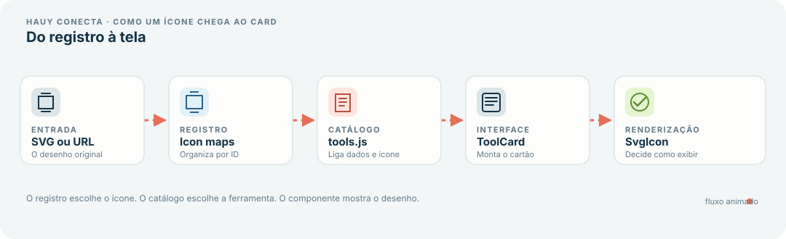

# Guia para iniciantes: SvgIcon, ícones de ferramentas e ToolCard

> **Revisão técnica:** 2026-11-01. O componente atual está em `src/components/SvgIcon.jsx`; os dados dos cards ficam em `src/data/tools.js`, os provedores em `src/data/toolProviders.js` e os registros de SVG em `src/data/toolIcons/`. O código aceita SVG inline estático/confiável ou URL de imagem; não passe conteúdo SVG recebido de usuário/serviço externo para `dangerouslySetInnerHTML`.

> **Objetivo:** explicar, do começo ao fim, como os SVGs e links dos ícones entram no Hauy Conecta, como chegam ao componente `SvgIcon` e como aparecem dentro dos cards da página Ferramentas. Este guia também mostra como reproduzir a ideia em um projeto próprio com JavaScript, React, Tailwind CSS e Node.js.

## Índice

1. [Visão geral em um minuto](#1-visão-geral-em-um-minuto)
2. [Diagrama visual do fluxo](#2-diagrama-visual-do-fluxo)
3. [Onde cada arquivo fica](#3-onde-cada-arquivo-fica)
4. [Como o SvgIcon funciona](#4-como-o-svgicon-funciona)
5. [Como funcionam os registros iloveImgIcons e ilovePdfIcons](#5-como-funcionam-os-registros-iloveimgicons-e-ilovepdficons)
6. [Como tools.js conecta tudo](#6-como-toolsjs-conecta-tudo)
7. [Como ToolCard apresenta a ferramenta](#7-como-toolcard-apresenta-a-ferramenta)
8. [Receitas: SVG, link, ambos e fallback](#8-receitas-svg-link-ambos-e-fallback)
9. [Adicionar uma nova ferramenta](#9-adicionar-uma-nova-ferramenta)
10. [Usar SvgIcon sem a função cn](#10-usar-svgicon-sem-a-função-cn)
11. [Criar um projeto do zero com React, JavaScript, Tailwind e Node](#11-criar-um-projeto-do-zero-com-react-javascript-tailwind-e-node)
12. [Cuidados, acessibilidade e solução de problemas](#12-cuidados-acessibilidade-e-solução-de-problemas)
13. [Checklist final](#13-checklist-final)

---

## 1. Visão geral em um minuto

Pense no sistema como uma pequena esteira. Primeiro, você cadastra a representação visual do ícone. Depois, associa essa representação a uma ferramenta. Por fim, o card recebe os dados e mostra o ícone.

~~~text
SVG colado ou URL do SVG
          │
          ▼
iloveImgIcons / ilovePdfIcons
          │
          ▼
tools.js ── registra nome, descrição, categoria, link e ícone
          │
          ▼
ToolCard ── monta o cartão visual e o link para abrir a ferramenta
          │
          ▼
SvgIcon ── decide se renderiza SVG inline ou imagem por URL
          │
          ▼
Ícone aparece dentro do card
~~~

A regra principal é separar **dados** de **apresentação**:

- Os arquivos `src/data/toolIcons/iloveImg.js` e `src/data/toolIcons/ilovePdf.js` guardam as configurações visuais dos ícones.
- O arquivo `src/data/tools.js` cadastra as ferramentas e associa cada uma ao ícone correspondente.
- O componente `src/components/ToolCard.jsx` monta o cartão da ferramenta.
- O componente `src/components/SvgIcon.jsx` cuida de exibir um SVG colado no código ou uma imagem carregada por URL.

Isso evita repetir a lógica de renderização em cada cartão. Se o modo de exibir os ícones mudar, a alteração principal fica em `SvgIcon.jsx`, não em todas as ferramentas.

## 2. Diagrama visual do fluxo

A imagem abaixo é um diagrama SVG animado: os traços em movimento indicam o caminho dos dados. Ela é apenas uma ajuda visual da documentação; não faz parte da lógica React.

Também podemos representar esse caminho com Mermaid. Em visualizadores Markdown que renderizam Mermaid, o diagrama vira uma imagem gerada pelo próprio visualizador:

~~~mermaid
flowchart LR
    A["SVG inline ou URL"] --> B["iloveImgIcons / ilovePdfIcons"]
    B --> C["tools.js"]
    C --> D["ToolCard.jsx"]
    D --> E["SvgIcon.jsx"]
    E --> F["Ícone renderizado"]
~~~

### O que acontece quando a página é montada?

1. A página que usa a lista de ferramentas importa `tools`.
2. Cada objeto da lista já tem um campo `icon`.
3. `ToolCard` recebe uma ferramenta por meio da propriedade `tool`.
4. `ToolCard` entrega `tool.icon` para `SvgIcon`.
5. `SvgIcon` verifica o formato recebido e escolhe o elemento de renderização.

O link que abre a ferramenta é independente do desenho do ícone: ele vem de `tool.href`. O endereço do SVG, por outro lado, fica dentro de `tool.icon.src`, quando o ícone é remoto.

---

## 3. Onde cada arquivo fica

| Caminho | Responsabilidade |
| --- | --- |
| `src/components/SvgIcon.jsx` | Renderiza SVG inline ou imagem por URL. |
| `src/components/ToolCard.jsx` | Monta o cartão visual e o link de destino. |
| `src/data/toolIcons/iloveImg.js` | Registra os ícones das ferramentas do iLoveIMG. |
| `src/data/toolIcons/ilovePdf.js` | Registra os ícones das ferramentas do iLovePDF. |
| `src/data/tools.js` | Reúne os dados de cada ferramenta e relaciona cada item ao ícone. |
| `src/lib/utils.js` | Fornece a função utilitária `cn`, usada para combinar classes CSS. |

> **Importante:** `iloveImgIcons` e `ilovePdfIcons` são objetos JavaScript usados pelo projeto para organizar os ícones. Não são bibliotecas instaladas via npm.

### Uma analogia simples

Imagine uma loja:

- `iloveImgIcons` e `ilovePdfIcons` são as prateleiras onde você organiza os desenhos.
- `tools.js` é o catálogo que diz qual desenho pertence a qual produto.
- `ToolCard` é a etiqueta/cartão que mostra o produto ao visitante.
- `SvgIcon` é a pessoa responsável por apresentar o desenho da forma adequada.

---

## 4. Como o SvgIcon funciona

O componente atual está em `src/components/SvgIcon.jsx`. Ele recebe quatro propriedades:

| Propriedade | Para que serve |
| --- | --- |
| `icon` | O SVG em texto ou um objeto que contém `svg` e/ou `src`. |
| `className` | Classes CSS/Tailwind usadas para definir o tamanho e o encaixe. O padrão é `size-9`. |
| `fallbackSrc` | Imagem alternativa se o navegador não conseguir carregar uma imagem por URL. |
| `title` | Nome acessível do ícone. Quando omitido, o ícone é tratado como decorativo. |

### A decisão dentro do componente

~~~mermaid
flowchart TD
    A["SvgIcon recebe icon"] --> B{"icon é uma string?"}
    B -- "Sim" --> C["A string é tratada como SVG inline"]
    B -- "Não" --> D["Lê icon.svg e icon.src"]
    C --> E{"Começa com <svg?"}
    D --> F{"svg inline válido?"}
    E -- "Sim" --> G["Renderiza o SVG inline"]
    E -- "Não" --> H["Não há URL no caso de string"]
    F -- "Sim" --> G
    F -- "Não" --> I{"Existe src?"}
    I -- "Sim" --> J["Renderiza img com src"]
    I -- "Não" --> K["Retorna null"]
~~~

Em termos práticos, o componente segue esta ordem:

1. Se `icon` for uma string, usa essa string como candidato a SVG inline.
2. Se `icon` for um objeto, lê `icon.svg` e `icon.src`.
3. Se o texto de SVG começar com `<svg` depois de remover espaços das extremidades, ele é inserido diretamente na página.
4. Caso não use SVG inline, tenta usar `src` como fonte de um elemento ``.
5. Se não houver SVG inline válido nem `src`, retorna `null`, ou seja, não mostra um ícone.
6. Se uma imagem de `src` falhar, tenta carregar `fallbackSrc`, desde que essa propriedade tenha sido passada.

### Por que existem duas maneiras de mostrar SVG?

**SVG inline:** o texto do SVG fica dentro do código JavaScript. O componente insere esse conteúdo no HTML da página.

**SVG por URL:** o JavaScript guarda apenas o endereço do arquivo. O navegador carrega o conteúdo como uma imagem, usando ``.

Para uma URL, use um objeto com `src`. Não passe apenas uma URL como string, porque o componente atual interpreta strings como conteúdo SVG, não como endereços.

~~~jsx
// Correto: SVG guardado como texto
<SvgIcon icon={{ svg: "<svg viewBox='0 0 24 24'>...</svg>" }} />

// Correto: SVG carregado por endereço
<SvgIcon icon={{ src: "https://exemplo.com/icone.svg" }} />

// Incorreto para o componente atual: uma string URL não é reconhecida como URL
<SvgIcon icon="https://exemplo.com/icone.svg" />
~~~

O exemplo inline acima é apenas ilustrativo; na aplicação real, use um SVG completo e confiável.

### Por que o componente usa `cn`?

No projeto, `cn` vem de `src/lib/utils.js`:

~~~js
import { clsx } from "clsx";
import { twMerge } from "tailwind-merge";

export function cn(...inputs) {
    return twMerge(clsx(inputs));
}
~~~

A função combina classes condicionalmente com `clsx` e resolve conflitos comuns entre classes Tailwind com `tailwind-merge`. Por exemplo, se duas classes definirem tamanhos conflitantes, a função pode manter a classe que deve prevalecer.

No `SvgIcon`, `cn` combina as classes-base com a classe enviada por quem usa o componente. Ela não é o que carrega ou interpreta o SVG. O desenho pode aparecer sem `cn`; essa função só ajuda a organizar as classes CSS.

---

## 5. Como funcionam os registros iloveImgIcons e ilovePdfIcons

Abra um destes arquivos:

- `src/data/toolIcons/iloveImg.js`
- `src/data/toolIcons/ilovePdf.js`

O registro é um objeto JavaScript. Cada chave representa um identificador de ferramenta, e seu valor descreve de onde vem o ícone.

### Exemplo atual com URL

~~~js
const baseUrl = "https://www.iloveimg.com/img/tools/small";

export const iloveImgIcons = Object.freeze({
    "comprimir-imagem": {
        src: baseUrl + "/compressimage.svg",
    },
    "redimensionar-imagem": {
        src: baseUrl + "/resizeimage.svg",
    },
});
~~~

Neste exemplo:

- `baseUrl` guarda o início do endereço que se repete.
- `"comprimir-imagem"` é a chave que identifica a ferramenta.
- `src` guarda a URL do ícone.
- `Object.freeze(...)` impede a substituição das propriedades de primeiro nível desse objeto depois de criado.

O mesmo padrão é usado pelo registro de ícones do iLovePDF, que tem seu próprio `baseUrl`.

### Exemplo com SVG colado

~~~js
export const iloveImgIcons = Object.freeze({
    "meu-icone": {
        svg: String.raw`<svg xmlns="http://www.w3.org/2000/svg" viewBox="0 0 48 48" width="48" height="48" fill="none">
    <circle cx="24" cy="24" r="18" fill="#E66F58" />
    <path d="M15 24l6 6 13-14" stroke="#FFFFFF" stroke-width="3" stroke-linecap="round" stroke-linejoin="round" />
</svg>`,
    },
});
~~~

Aqui, o conteúdo entre as crases é guardado como texto. `String.raw` ajuda a preservar barras invertidas literais quando o SVG precisa delas. O elemento `<svg>` contém as formas vetoriais que o navegador vai desenhar.

**Atenção às crases:** a crase que inicia `String.raw` também precisa ser fechada depois de `</svg>`. Não coloque um ponto e vírgula *dentro* do texto depois de `</svg>`; o fechamento correto é `</svg>` seguido da crase. Se o ponto e vírgula ficar dentro da string, ele deixa de ser parte da sintaxe JavaScript e pode acabar como texto extra junto ao ícone.

### Por que as chaves precisam combinar com os IDs?

Em `tools.js`, o registro é consultado assim:

~~~js
icon: iloveImgIcons["comprimir-imagem"],
~~~

Isso significa que a chave deve ser exatamente igual. Se você escrever `"comprimir-imagens"` no registro e tentar acessar `"comprimir-imagem"` em `tools.js`, o resultado será `undefined`, e o ícone não será encontrado.

### Quando usar registro separado?

Usar um arquivo só para ícones é útil quando:

- várias partes do projeto usam o mesmo ícone;
- o arquivo de ferramentas já está grande;
- você quer trocar a URL por SVG inline sem misturar isso às descrições;
- quer encontrar e corrigir uma imagem em um lugar só.

Para um projeto pequeno, também é possível guardar a propriedade `icon` diretamente no objeto da ferramenta. Os exemplos da seção 8 mostram essa alternativa.

---

## 6. Como tools.js conecta tudo

O arquivo `src/data/tools.js` é o catálogo de ferramentas. Cada objeto do array `tools` descreve um cartão e liga a ferramenta ao registro de ícones.

Veja um exemplo reduzido baseado na estrutura usada pelo projeto:

~~~js
import { iloveImgIcons } from "./toolIcons/iloveImg";
import { ilovePdfIcons } from "./toolIcons/ilovePdf";

export const tools = [
    {
        id: "comprimir-imagem",
        name: "Comprimir imagem",
        category: "Imagens",
        description: "Diminua o tamanho de um arquivo de imagem.",
        provider: "iLoveIMG",
        href: "https://www.iloveimg.com/pt/comprimir-imagem",
        icon: iloveImgIcons["comprimir-imagem"],
        featured: true,
    },
    {
        id: "juntar-pdf",
        name: "Juntar PDF",
        category: "PDF",
        description: "Combine vários PDFs em um único arquivo.",
        provider: "iLovePDF",
        href: "https://www.ilovepdf.com/pt/juntar_pdf",
        icon: ilovePdfIcons["juntar-pdf"],
    },
];
~~~

### O significado de cada campo

| Campo | Significado |
| --- | --- |
| `id` | Identificador estável, útil para filtros, chaves e consultas. |
| `name` | Nome que aparece ao visitante. |
| `category` | Grupo da ferramenta, como `PDF` ou `Imagens`. |
| `description` | Explica resumidamente o que a ferramenta faz. |
| `provider` | Indica qual site oferece a ferramenta; o `ToolCard` também usa esse valor para selecionar um logo alternativo. |
| `href` | Link de destino ao clicar no cartão. Não é o link do ícone. |
| `icon` | Objeto do registro de ícones, com `svg`, `src` ou ambos. |
| `featured` | Campo opcional usado quando a interface precisa destacar uma ferramenta. |

O nome `icon` não precisa vir de um dos registros existentes. O componente `SvgIcon` aceita outros objetos com a mesma estrutura. Os registros são uma escolha de organização do projeto, não uma limitação do React.

### Um detalhe importante: dois tipos de endereço

~~~text
tool.href       → destino ao clicar no card
tool.icon.src   → endereço da imagem do ícone, quando o ícone é remoto
~~~

Não substitua `href` pelo endereço do arquivo SVG. Fazer isso faria o cartão abrir a imagem em vez de abrir a ferramenta.

---

## 7. Como ToolCard apresenta a ferramenta

O componente `src/components/ToolCard.jsx` recebe um único objeto pela propriedade `tool`. Ele usa os dados para montar o cartão.

Parte simplificada do componente:

~~~jsx
import { SvgIcon } from "./SvgIcon";

export function ToolCard({ tool }) {
    const providerLogo =
        tool.provider === "iLovePDF" ? "/ilovePDF.svg" : "/iloveIMG.svg";

    return (
        <a
            href={tool.href}
            target="_blank"
            rel="noopener noreferrer"
            aria-label={
                "Abrir a ferramenta " + tool.name +
                " no " + tool.provider +
                ". Abre em uma nova aba."
            }
            className="block rounded-xl"
        >
            

                
                    <SvgIcon
                        icon={tool.icon}
                        fallbackSrc={providerLogo}
                        className="size-9"
                    />
                

                

                    <h3>{tool.name}</h3>
                    
{tool.description}

                

            

        </a>
    );
}
~~~

> Este trecho é uma versão didática reduzida. O componente real inclui os componentes visuais do projeto, categorias, textos de ação e classes de hover/foco.

### Qual é a função do logo alternativo?

Se o ícone de uma ferramenta usa uma URL e essa imagem não carregar, `SvgIcon` tenta usar `fallbackSrc`. No `ToolCard` atual, o valor é escolhido pelo provedor:

- para `iLovePDF`, o fallback é `/ilovePDF.svg`;
- para as demais ferramentas no fluxo atual, o fallback é `/iloveIMG.svg`.

Esse fallback é o **logo do provedor**, não necessariamente o ícone individual da ferramenta. Por exemplo, o ícone específico de “Comprimir imagem” pode falhar e o usuário ainda verá o logo do iLoveIMG.

O fallback só consegue ajudar se o próprio arquivo alternativo estiver disponível e se o navegador conseguir carregá-lo.

---

## 8. Receitas: SVG, link, ambos e fallback

Esta seção reúne os cenários mais comuns. Em todos os casos, lembre-se de que o **link de destino da ferramenta** (`href`) e a **fonte do ícone** (`icon.src`) têm funções diferentes.

### Cenário A — usar somente SVG inline

Use quando você tem o código SVG e quer guardá-lo no projeto, sem buscar o desenho em outro servidor.

~~~js
// src/data/toolIcons/meusIcons.js
export const meusIcons = {
    "salvar-arquivo": {
        svg: String.raw`<svg xmlns="http://www.w3.org/2000/svg" viewBox="0 0 48 48">
    <rect x="5" y="5" width="38" height="38" rx="8" fill="#133345" />
    <path d="M14 24l7 7 14-15" fill="none" stroke="#FFFFFF" stroke-width="3" />
</svg>`,
    },
};
~~~

Em `tools.js`:

~~~js
import { meusIcons } from "./toolIcons/meusIcons";

const ferramenta = {
    id: "salvar-arquivo",
    name: "Salvar arquivo",
    category: "Arquivos",
    description: "Exemplo de ferramenta com SVG próprio.",
    provider: "MeuProjeto",
    href: "https://exemplo.com/salvar",
    icon: meusIcons["salvar-arquivo"],
};
~~~

O `SvgIcon` recebe o objeto e identifica o campo `svg`. Não é necessário criar um arquivo `.svg` separado nem fazer uma requisição para buscar o ícone.

**Vantagens:** o ícone fica disponível junto com o código; não depende de uma URL externa para renderizar.

**Cuidados:** o SVG aumenta o tamanho do arquivo JavaScript e deve ser uma string estática e confiável. Para muitos SVGs muito grandes, arquivos separados podem ser mais fáceis de manter.

### Cenário B — usar somente uma URL

Use quando o ícone já existe em um endereço acessível, como uma imagem hospedada no seu site ou em um servidor externo.

~~~js
export const meusIcons = {
    "editar-foto": {
        src: "https://exemplo.com/icones/editar-foto.svg",
    },
};
~~~

O `SvgIcon` criará um `` e usará a URL em `src`. A URL deve apontar para um arquivo de imagem que o navegador possa acessar.

**Vantagens:** o registro JavaScript fica pequeno e o SVG pode ser atualizado no servidor sem alterar o código do registro.

**Cuidados:** a URL pode deixar de existir, o servidor pode ficar indisponível ou bloquear o acesso. Uma URL remota também significa que o projeto depende daquele serviço para mostrar a imagem. No `ToolCard`, use `fallbackSrc` para dar uma alternativa visual.

### Cenário C — guardar SVG e URL no mesmo objeto

Você pode colocar os dois campos:

~~~js
export const meusIcons = {
    "editar-foto": {
        svg: String.raw`<svg xmlns="http://www.w3.org/2000/svg" viewBox="0 0 24 24">
    <circle cx="12" cy="12" r="10" fill="#E66F58" />
    <path d="M7 12h10" stroke="#FFFFFF" stroke-width="2" />
</svg>`,
        src: "https://exemplo.com/icones/editar-foto.svg",
    },
};
~~~

**No componente atual, o SVG inline tem prioridade.** Se `svg` começa com `<svg`, `SvgIcon` retorna o SVG inline, e o campo `src` não é usado naquela renderização. A existência de ambos no objeto não significa que o componente tentará o endereço caso o SVG inline esteja incompleto ou não desenhe corretamente.

Se a sua intenção é **usar a URL como fallback quando o SVG inline falhar**, você precisa alterar explicitamente a lógica do componente para esse comportamento. O `fallbackSrc` atual é usado quando uma imagem `` falha, e não para testar se um SVG inline está visualmente correto.

### Cenário D — ícone por URL e fallback do provedor

~~~jsx
<SvgIcon
    icon={{ src: "https://exemplo.com/icones/comprimir.svg" }}
    fallbackSrc="/logos/meu-provedor.svg"
    title="Comprimir"
/>
~~~

Se `comprimir.svg` não carregar, o componente tenta `/logos/meu-provedor.svg`. O fallback é outra imagem, por isso a propriedade deve receber uma URL válida.

Se a intenção for usar isso em `ToolCard`, normalmente o próprio card já escolhe o `fallbackSrc` com base no campo `provider`.

### Cenário E — usar o ícone direto, sem registro separado

Para uma aplicação muito pequena, você pode colocar o SVG diretamente no objeto da ferramenta:

~~~js
export const tools = [
    {
        id: "recortar",
        name: "Recortar imagem",
        category: "Imagens",
        description: "Define a área que será mantida.",
        provider: "MeuProjeto",
        href: "https://exemplo.com/recortar",
        icon: {
            svg: String.raw`<svg xmlns="http://www.w3.org/2000/svg" viewBox="0 0 24 24">
    <rect x="5" y="5" width="14" height="14" fill="none" stroke="#133345" stroke-width="2" />
</svg>`,
        },
    },
];
~~~

Essa forma funciona porque `ToolCard` só precisa receber `tool.icon` no formato esperado por `SvgIcon`. O registro separado é recomendado quando você quer manter dados e desenhos organizados.

### Cenário F — registro com mistura de SVGs e URLs

O mesmo registro pode conter os dois formatos, ferramenta por ferramenta:

~~~js
export const meusIcons = {
    "icone-local": {
        svg: String.raw`<svg xmlns="http://www.w3.org/2000/svg" viewBox="0 0 24 24">
    <circle cx="12" cy="12" r="9" fill="#133345" />
</svg>`,
    },

    "icone-remoto": {
        src: "https://exemplo.com/icones/icone-remoto.svg",
    },
};
~~~

Não existe a exigência de que todos os valores de `meusIcons` tenham o mesmo formato. O importante é que cada item tenha pelo menos um campo que o componente consiga usar.

---

## 9. Adicionar uma nova ferramenta

Este é o fluxo recomendado no Hauy Conecta quando a ferramenta pertence a um provedor que já existe.

### Passo 1 — adicionar o ícone ao registro

No arquivo apropriado, escolha uma chave simples e estável. Se for uma ferramenta de imagens, por exemplo, adicione em `src/data/toolIcons/iloveImg.js`:

~~~js
"marcar-imagem": {
    src: baseUrl + "/watermarkimage.svg",
},
~~~

Se preferir colar um SVG, use a propriedade `svg` no lugar de `src`. Não é obrigatório que o ícone seja remoto.

### Passo 2 — importar o registro em tools.js

Se o registro já está importado no início de `src/data/tools.js`, não precisa importar de novo. O arquivo do projeto já importa `iloveImgIcons` e `ilovePdfIcons`.

### Passo 3 — registrar o item em tools.js

~~~js
{
    id: "marcar-imagem",
    name: "Marcar imagem",
    category: "Imagens",
    description: "Adicione texto ou uma imagem por cima de uma foto.",
    provider: "iLoveIMG",
    href: "https://www.iloveimg.com/pt/marcar-imagem",
    icon: iloveImgIcons["marcar-imagem"],
}
~~~

### Passo 4 — conferir a chave e testar

Confira o seguinte:

1. A chave em `iloveImgIcons` e a usada em `tools.js` são idênticas.
2. O campo `href` abre a ferramenta certa.
3. Se o ícone usar URL, abra essa URL no navegador e verifique se o arquivo existe.
4. Rode o projeto, vá à página Ferramentas e confira o ícone em tamanho real.
5. Confira também se o fallback aparece caso você teste uma URL inválida temporariamente.

### Adicionar uma ferramenta de outro provedor

O `ToolCard` atual seleciona o fallback com base em `tool.provider`. Se você adicionar um terceiro provedor, revise a variável `providerLogo` em `ToolCard.jsx`; caso contrário, o código atual usará o fallback do iLoveIMG para qualquer provedor que não seja exatamente `iLovePDF`.

Uma forma de escalar isso é guardar a URL do logo em cada ferramenta ou manter um mapa de logos por provedor. Para o conjunto atual de iLovePDF e iLoveIMG, o código existente usa uma condição simples.

---

## 10. Usar SvgIcon sem a função cn

Se você copiar o componente para outro projeto e ainda não tiver `cn`, não precisa instalar `clsx` nem `tailwind-merge` só para renderizar ícones. É possível escrever uma versão menor usando `className` diretamente.

Abaixo está uma versão independente. Ela mantém o comportamento principal — SVG inline ou URL — e o fallback de uma imagem por URL. Não depende de `../lib/utils`.

~~~jsx
// src/components/SvgIcon.jsx
export function SvgIcon({
    icon,
    className = "size-9",
    fallbackSrc,
    title,
}) {
    const inlineSvg = typeof icon === "string" ? icon : icon?.svg;
    const src = typeof icon === "object" && icon !== null
        ? icon.src
        : undefined;

    const accessibilityProps = title
        ? { role: "img", "aria-label": title }
        : { "aria-hidden": true };

    if (
        typeof inlineSvg === "string" &&
        inlineSvg.trim().startsWith("<svg")
    ) {
        return (
            svg]:block [&>svg]:h-full [&>svg]:w-full " +
                    className
                }
                {...accessibilityProps}
                dangerouslySetInnerHTML={{ __html: inlineSvg }}
            />
        );
    }

    if (!src) return null;

    return (
         {
                const image = event.currentTarget;

                if (
                    fallbackSrc &&
                    image.getAttribute("src") !== fallbackSrc
                ) {
                    image.setAttribute("src", fallbackSrc);
                }
            }}
        />
    );
}
~~~

### O que foi removido?

Na versão sem `cn`, as classes são concatenadas com o operador `+`:

~~~js
"classe fixa " + className
~~~

Isso é suficiente para um caso simples. A versão independente não resolve conflitos de classes Tailwind tão bem quanto `cn` pode resolver com `tailwind-merge`, mas não precisa dessas bibliotecas para o componente funcionar.

**Atenção:** o Tailwind ainda precisa estar instalado e configurado se você quiser usar classes como `size-9`, `inline-flex` e `object-contain`. Retirar `cn` não instala nem substitui o Tailwind; apenas retira a dependência dessa função utilitária.

### Registro de dados independente

Você também pode criar um arquivo `src/data/icons.js` com SVGs ou URLs:

~~~js
// src/data/icons.js
export const icons = {
    "arquivo-local": {
        svg: String.raw`<svg xmlns="http://www.w3.org/2000/svg" viewBox="0 0 24 24">
    <rect x="4" y="4" width="16" height="16" rx="3" fill="#133345" />
</svg>`,
    },

    "arquivo-remoto": {
        src: "https://exemplo.com/icones/arquivo.svg",
    },
};
~~~

Depois, use o objeto em qualquer componente:

~~~jsx
import { SvgIcon } from "./components/SvgIcon";
import { icons } from "./data/icons";

export function Exemplo() {
    return (
        

            <SvgIcon icon={icons["arquivo-local"]} title="Arquivo local" />
            <SvgIcon icon={icons["arquivo-remoto"]} title="Arquivo remoto" />
        

    );
}
~~~

O registro `icons` é apenas um exemplo genérico. No Hauy Conecta, você pode continuar usando os nomes específicos `iloveImgIcons` e `ilovePdfIcons`.

---

## 11. Criar um projeto do zero com React, JavaScript, Tailwind e Node

Esta parte mostra uma aplicação pequena e independente do Hauy Conecta. Você terá um registro de ícones, o componente `SvgIcon` e cartões com animação discreta ao passar o mouse.

### 11.1. Pré-requisitos

Instale uma versão de Node.js compatível com a versão atual do Vite. Depois, confirme no terminal:

~~~bash
node -v
npm -v
~~~

O Node executa ferramentas de desenvolvimento; o npm instala as dependências do projeto.

### 11.2. Criar o projeto React com Vite

~~~bash
npm create vite@latest svg-icon-lab -- --template react
cd svg-icon-lab
npm install
npm install tailwindcss @tailwindcss/vite
~~~

A opção `react` cria um projeto React que usa JavaScript por padrão, sem exigir TypeScript.

### 11.3. Configurar o Tailwind CSS

Atualize o arquivo `vite.config.js` para usar o plugin do Tailwind:

~~~js
import { defineConfig } from "vite";
import react from "@vitejs/plugin-react";
import tailwindcss from "@tailwindcss/vite";

export default defineConfig({
    plugins: [react(), tailwindcss()],
});
~~~

No CSS principal, por exemplo `src/index.css`, coloque:

~~~css
@import "tailwindcss";

@keyframes icon-float {
    0%, 100% {
        transform: translateY(0);
    }

    50% {
        transform: translateY(-3px);
    }
}

.icon-float {
    animation: icon-float 2.4s ease-in-out infinite;
}

@media (prefers-reduced-motion: reduce) {
    .icon-float {
        animation: none;
    }
}
~~~

Importe o CSS em `src/main.jsx`:

~~~jsx
import { StrictMode } from "react";
import { createRoot } from "react-dom/client";
import App from "./App.jsx";
import "./index.css";

createRoot(document.getElementById("root")).render(
    <StrictMode>
        <App />
    </StrictMode>,
);
~~~

A animação acima é puramente visual. O `prefers-reduced-motion` respeita a preferência do sistema para reduzir animações.

### 11.4. Criar a estrutura de pastas

Dentro de `src`, crie os arquivos abaixo:

~~~text
src/
├── components/
│   ├── SvgIcon.jsx
│   └── ToolCard.jsx
├── data/
│   ├── icons.js
│   └── tools.js
├── App.jsx
├── index.css
└── main.jsx
~~~

### 11.5. Criar o componente SvgIcon

Use a versão independente apresentada na seção 10 e salve-a como `src/components/SvgIcon.jsx`. Assim você começa com a menor quantidade de dependências.

### 11.6. Criar os ícones

Crie `src/data/icons.js`:

~~~js
export const icons = {
    "ajuda-local": {
        svg: String.raw`<svg xmlns="http://www.w3.org/2000/svg" viewBox="0 0 48 48" width="48" height="48" fill="none">
    <rect x="3" y="3" width="42" height="42" rx="11" fill="#133345" />
    <circle cx="24" cy="24" r="12" fill="#E66F58" />
    <path d="M24 17v14M17 24h14" stroke="#FFFFFF" stroke-width="3" stroke-linecap="round" />
</svg>`,
    },

    "abrir-site": {
        src: "https://exemplo.com/icones/abrir-site.svg",
    },
};
~~~

Troque a URL de demonstração por um arquivo real quando for testar o ícone remoto. O exemplo de `ajuda-local` já é inline e não precisa de uma URL.

### 11.7. Criar a lista de ferramentas

Crie `src/data/tools.js`:

~~~js
import { icons } from "./icons";

export const tools = [
    {
        id: "ajuda-local",
        name: "Ajuda local",
        description: "Exibe um SVG guardado no próprio projeto.",
        href: "https://example.com/ajuda",
        icon: icons["ajuda-local"],
    },
    {
        id: "abrir-site",
        name: "Ícone remoto",
        description: "Carrega um SVG por URL.",
        href: "https://example.com/ferramenta",
        icon: icons["abrir-site"],
    },
];
~~~

Os endereços `example.com` são placeholders de documentação. Substitua-os pelos links corretos antes de publicar o seu projeto.

### 11.8. Criar o cartão com efeito ao passar o mouse

Crie `src/components/ToolCard.jsx`:

~~~jsx
import { SvgIcon } from "./SvgIcon";

export function ToolCard({ tool }) {
    return (
        <a
            href={tool.href}
            target="_blank"
            rel="noopener noreferrer"
            className="
                group block rounded-2xl border border-slate-200 bg-white p-5
                transition duration-200 ease-out
                hover:-translate-y-1 hover:border-slate-400 hover:shadow-lg
                focus-visible:outline-none focus-visible:ring-2
                focus-visible:ring-slate-500
                motion-reduce:transform-none motion-reduce:transition-none
            "
        >
            
                <SvgIcon
                    icon={tool.icon}
                    className="size-10 transition-transform duration-200 group-hover:scale-105 motion-reduce:transform-none"
                    title={tool.name}
                />
            

            <h2 className="text-lg font-bold text-slate-900">
                {tool.name}
            </h2>

            

                {tool.description}
            

            
                Abrir ferramenta →
            
        </a>
    );
}
~~~

O Tailwind dá a aparência ao cartão. A animação de hover move o cartão levemente para cima e aumenta o ícone um pouco. A classe `motion-reduce:...` desativa as transições de movimento quando o sistema do visitante pede movimento reduzido.

### 11.9. Montar a página

Crie `src/App.jsx`:

~~~jsx
import { ToolCard } from "./components/ToolCard";
import { tools } from "./data/tools";

export default function App() {
    return (
        <main className="min-h-screen bg-slate-50 px-5 py-12">
            

                <header className="mb-8">
                    

                        Laboratório de ícones
                    

                    <h1 className="mt-2 text-3xl font-bold text-slate-950">
                        Ferramentas
                    </h1>

                    

                        Exemplo de cards que podem usar um SVG local ou uma URL.
                    

                </header>

                <section className="grid gap-4 sm:grid-cols-2 lg:grid-cols-3">
                    {tools.map((tool) => (
                        <ToolCard key={tool.id} tool={tool} />
                    ))}
                </section>
            

        </main>
    );
}
~~~

### 11.10. Rodar no computador

~~~bash
npm run dev
~~~

Abra o endereço local que o Vite apresentar no terminal. Para validar uma versão de produção:

~~~bash
npm run build
npm run preview
~~~

### Como esse projeto de exemplo se conecta

~~~mermaid
flowchart TD
    A["icons.js"] --> B["tools.js"]
    B --> C["App.jsx percorre tools"]
    C --> D["ToolCard recebe tool"]
    D --> E["SvgIcon recebe tool.icon"]
    E --> F["SVG inline ou img remoto"]
~~~

Você pode adicionar mais ferramentas sem criar um componente visual para cada uma. Normalmente basta criar a entrada de ícone, registrar uma nova ferramenta e deixar o React montar o card a partir do array.

---

## 12. Cuidados, acessibilidade e solução de problemas

### 12.1. O ícone não aparece

Verifique na seguinte ordem:

1. A chave está escrita exatamente igual em `icons.js`/registro e em `tools.js`?
2. O objeto tem `svg` ou `src`?
3. Se for SVG inline, começa com a abertura `<svg`? O componente faz uma verificação simples dessa abertura.
4. Se for URL, ela abre no navegador e responde com o arquivo correto?
5. O SVG tem um `viewBox` adequado e formas dentro da área visível?
6. As cores do ícone contrastam com o fundo?
7. O tamanho passado em `className` é suficiente?

O componente não consegue detectar se o conteúdo de um SVG inline está visualmente correto. Ele verifica somente o formato inicial e insere o conteúdo.

### 12.2. O ícone é cortado ou fica invisível

Um SVG pode ter sido desenhado para um fundo claro, ter elementos brancos sem contorno ou ter coordenadas fora do seu `viewBox`. Confira:

~~~xml
<svg
    xmlns="http://www.w3.org/2000/svg"
    viewBox="0 0 48 48"
    width="48"
    height="48"
>
    <!-- As formas precisam ficar dentro da área definida pelo viewBox. -->
</svg>
~~~

- `viewBox` define a área vetorial considerada pelo navegador.
- `fill` define a cor de preenchimento.
- `stroke` define a cor do contorno.
- `width` e `height` definem as dimensões declaradas no SVG; as classes CSS também podem influenciar o tamanho final.
- `fill="none"` deixa o preenchimento transparente; não significa que o SVG inteiro será invisível, pois pode haver contornos.

Se o ícone tiver detalhes importantes, teste-o no fundo que a interface realmente usa. Um fundo branco atrás do ícone no card ajuda a dar uma superfície previsível, mas o SVG ainda precisa ter cores e formas visíveis.

### 12.3. O ícone mostra um caractere extra no final

Confira o conteúdo literal do SVG. A string deve terminar com `</svg>` e, em seguida, deve vir a crase que fecha `String.raw`.

~~~js
// Correto: o ponto e vírgula fica fora da string, depois da crase.
svg: String.raw`<svg xmlns="http://www.w3.org/2000/svg" viewBox="0 0 24 24">
    <circle cx="12" cy="12" r="8" fill="#133345" />
</svg>`,
~~~

Não use `</svg>;`` com o ponto e vírgula ainda dentro do texto. O caractere passa a fazer parte do valor de `svg`, não da sintaxe JavaScript.

### 12.4. URL do ícone não carrega

Acesse a URL diretamente. Se ela não funcionar no navegador, o componente também não conseguirá mostrar essa imagem. Confira a grafia, a conexão e se o servidor ainda disponibiliza o arquivo.

Para imagens externas, uma alternativa local costuma ser mais confiável. Você pode salvar o SVG em uma pasta pública do seu projeto e usar, por exemplo, `src: "/icons/minha-ferramenta.svg"`. Arquivos da pasta pública geralmente são servidos a partir da raiz do site.

### 12.5. O que muda entre `svg`, `src` e `href`?

| Propriedade | O que representa |
| --- | --- |
| `icon.svg` | Código vetorial como texto, inserido no HTML. |
| `icon.src` | URL do arquivo de imagem do ícone. |
| `tool.href` | Endereço da ferramenta que será aberta ao clicar no card. |
| `fallbackSrc` | Endereço alternativo, usado se uma imagem por URL falhar. |

São quatro papéis diferentes. Manter essa separação evita que o card abra a imagem do ícone ao invés da ferramenta.

### 12.6. Segurança de SVG inline

O componente usa `dangerouslySetInnerHTML` para inserir o texto do SVG. Isso é adequado somente para conteúdo estático e confiável, como SVGs revisados que você controla no código.

**Não passe conteúdo SVG recebido diretamente de visitantes, formulários ou serviços desconhecidos sem sanitização adequada.** SVG pode conter conteúdo ativo e referências externas; inserir HTML sem confiança é um risco de segurança.

Use preferencialmente arquivos de fontes confiáveis e revise o conteúdo antes de adicionar ao registro. Se você não precisa inserir o SVG inline, usar `src` com `` pode ser uma opção mais simples.

### 12.7. Acessibilidade

- Para um ícone decorativo dentro de um link que já possui nome acessível, manter o ícone oculto da árvore de acessibilidade é aceitável. É o comportamento padrão de `SvgIcon` sem `title`.
- Quando o ícone comunica uma informação que não aparece em texto, passe `title` para definir um nome acessível.
- O link do card deve explicar o destino. No `ToolCard` do Hauy Conecta, o link possui um `aria-label` descrevendo a ferramenta, o provedor e a abertura em nova aba.
- Não dependa apenas da cor para distinguir ferramentas.

### 12.8. Animações sem atrapalhar o visitante

Animações devem ser pequenas e opcionais. Prefira efeitos de entrada/hover que não atrapalhem o uso, e respeite a preferência `prefers-reduced-motion`. No exemplo de projeto deste guia, as animações de movimento são desativadas para quem prefere movimento reduzido.

A animação do diagrama desta documentação serve apenas para destacar a direção do fluxo. Ela não é uma dependência do componente `SvgIcon` e pode ser removida sem afetar o código do site.

---

## 13. Checklist final

Antes de considerar uma nova ferramenta pronta, confira:

- [ ] O identificador `id` não se repete.
- [ ] A chave do registro de ícones corresponde ao identificador escolhido.
- [ ] O objeto `icon` tem `svg`, `src` ou o formato combinado esperado.
- [ ] Se for usar URL, ela aponta para um arquivo acessível.
- [ ] Se for usar SVG inline, a string contém um SVG completo e confiável.
- [ ] O SVG não tem um ponto e vírgula ou outro caractere indesejado depois de `</svg>`.
- [ ] As cores têm contraste com o fundo em que o ícone será exibido.
- [ ] O campo `href` abre a ferramenta, não a imagem do ícone.
- [ ] O fallback, quando necessário, também está acessível.
- [ ] O cartão pode ser usado por teclado e tem nome acessível.
- [ ] A interface foi testada com o tamanho real do card.
- [ ] Se usar animação, ela respeita a preferência por movimento reduzido.

**Resumo:** o registro de ícones decide *qual desenho usar*; `tools.js` decide *qual ferramenta recebe esse desenho*; `ToolCard` monta o cartão; e `SvgIcon` decide *como desenhar o ícone*. Essa separação torna o código mais fácil de entender, testar e manter.
