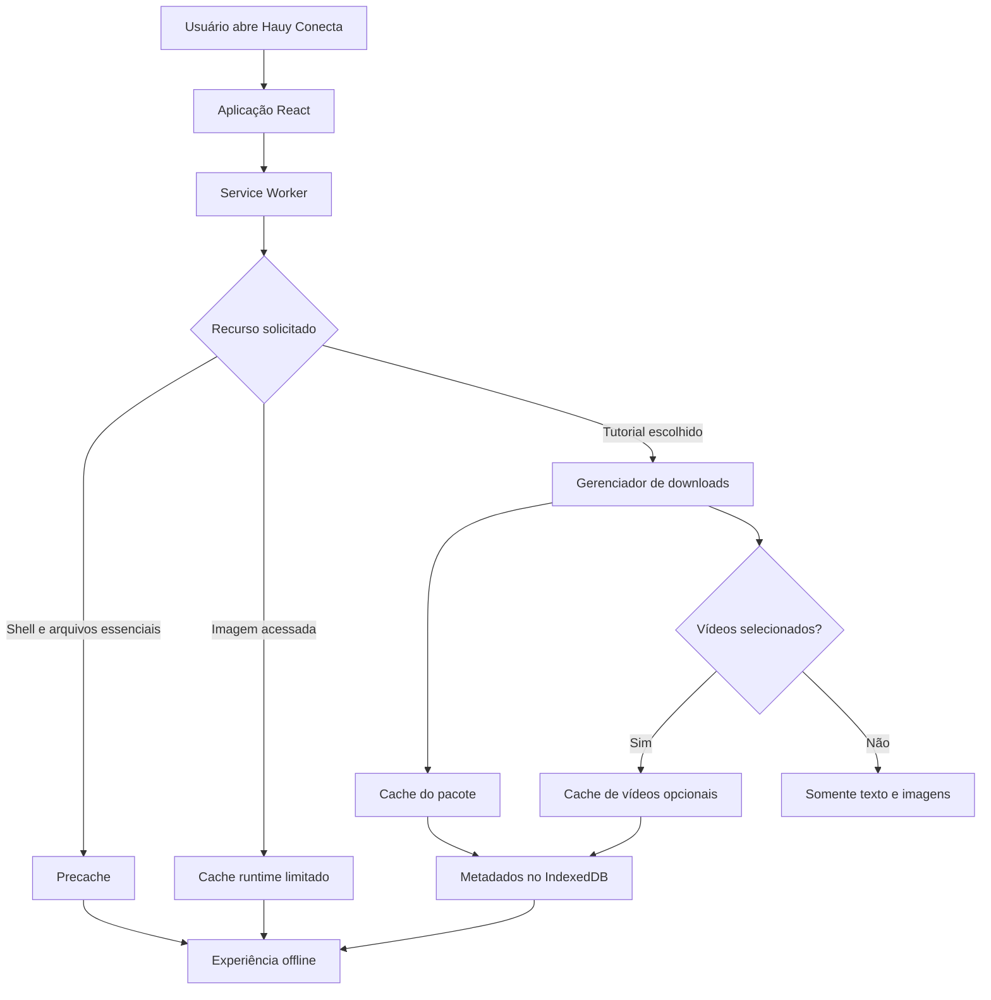

# Hauy Conecta --- Arquitetura e Planejamento do PWA

> **Status:** auditoria da Fase 0 registrada; implementação do PWA ainda não iniciada.\
> **Modelo:** híbrido --- conteúdo básico e imagens essenciais em cache,
> com download opcional de tutoriais e vídeos.

## 1. Objetivo e limite desta etapa

Este documento define como o Hauy Conecta deverá funcionar como
Progressive Web App (PWA), as tecnologias previstas, as regras de cache,
o ciclo de vida dos downloads e os riscos a tratar antes da
implementação.

**Importante:** a arquitetura foi definida antes da implementação. O trabalho agora seguirá fases pequenas na branch `feat/pwa`, preservando `main` e `dev`. Cada fase deverá incluir testes adequados, validação do build completo e atualização desta documentação quando decisões ou comportamentos mudarem.

Este documento continua sendo a referência técnica principal para o PWA.

## 2. Contexto atual conhecido do projeto

Com base na análise anterior do repositório:

-   React, JavaScript/JSX, Vite e Tailwind CSS.
-   React Router para navegação.
-   Tutoriais e categorias definidos em arquivos estáticos, incluindo
    `src/data/tutorials.js` e `src/data/categories.js`.
-   Componentes de mídia como `OptimizedImage` e `OptimizedVideo`.
-   `useTutorialStepMedia.js` pré-carrega mídia da etapa atual em
    memória durante a sessão; isso **não** é armazenamento offline
    persistente.
-   Pré-renderização com Astratra.
-   Build que gera metadados de imagens, rotas pré-renderizadas, build
    Vite, pré-renderização e auditoria de imagens.
-   `dist/` versionado e publicado pela automação/GitHub Actions e
    Vercel.
-   Google Analytics 4 e eventos de início/conclusão de tutoriais.
-   APIs externas para assistente e suporte.

Na auditoria executada em **30/10/2026**, na base de trabalho da branch `feat/pwa` (`691ad05`), o diretório versionado `dist/` continha **983 arquivos e 354,77 MiB**. A distribuição observada foi:

- 18 arquivos MP4: **298,38 MiB** no total; o maior possui **66,63 MiB**.
- 822 arquivos WebP: **19,08 MiB**.
- 88 arquivos PNG: **28,34 MiB**.
- 5 arquivos SVG: **6,52 MiB**.
- 26 arquivos HTML, 20 arquivos JavaScript (1,02 MiB) e 1 arquivo CSS (73,7 KiB), além de favicon, sitemap e outros arquivos pequenos.

Os 822 WebP são arquivos presentes no artefato `dist/` e incluem variantes otimizadas/geradas; não devem ser interpretados como 822 imagens-fonte únicas.

A biblioteca `public/tutoriais/` possui 158 imagens-fonte e 18 vídeos distribuídos entre os oito tutoriais. Os vídeos estão concentrados em três tutoriais: `apresentacao-canva` (14), `como-comecar-usar-excel` (2) e `salvar-google-drive` (2). O tutorial de Canva concentra a maior parte do volume de vídeo.

**Consequência:** não colocar todos os vídeos ou toda a biblioteca de
imagens no precache inicial.

## 3. Decisão principal: modelo híbrido

### Camada A --- disponibilidade básica automática

Depois de uma primeira visita online, o navegador deverá ter recursos
suficientes para:

-   Abrir o aplicativo.
-   Navegar pela estrutura principal.
-   Consultar categorias e conteúdo textual dos tutoriais incluídos no
    pacote básico.
-   Usar a busca local, desde que os dados e chunks necessários estejam
    armazenados.
-   Exibir imagens essenciais previamente selecionadas.

Não deve baixar toda a biblioteca de mídia automaticamente.

### Camada B --- downloads escolhidos pelo usuário

O usuário poderá salvar um tutorial para uso offline. O pacote deverá
incluir:

-   Recursos necessários para abrir o tutorial.
-   Imagens das etapas e exemplos.
-   Pôsteres dos vídeos, quando existirem.
-   Vídeos somente quando o usuário selecionar explicitamente essa
    opção.

A interface deverá mostrar tamanho estimado, progresso, falhas, estado
de conclusão e opção de remoção.

**Princípio central:** não consumir dados móveis nem armazenamento de
forma inesperada, principalmente com vídeos.

## 4. Arquitetura proposta

### 4.1. Responsabilidades

  -----------------------------------------------------------------------
  Componente                          Responsabilidade
  ----------------------------------- -----------------------------------
  `vite-plugin-pwa`                   Integrar PWA ao build Vite,
                                      manifesto e Service Worker

  Workbox                             Precache, roteamento, estratégias e
                                      expiração de cache

  Web App Manifest                    Nome, ícones, cores, modo de
                                      exibição e instalação

  Service Worker                      Interceptar requisições e aplicar
                                      regras offline

  Cache Storage API                   Armazenar respostas HTTP dos
                                      recursos

  IndexedDB                           Metadados, estado, versões e
                                      recursos de cada pacote

  Gerenciador de downloads React      Selecionar, baixar, acompanhar e
                                      remover tutoriais

  Storage Manager API                 Estimar uso e solicitar
                                      persistência quando disponível

  Vercel                              Servir aplicação, manifesto e
                                      Service Worker em HTTPS
  -----------------------------------------------------------------------

### 4.2. Fluxo lógico



### 4.3. Separação lógica dos caches

  -------------------------------------------------------------------------
  Cache proposto            Conteúdo                Regra
  ------------------------- ----------------------- -----------------------
  `hauy-precache`           HTML necessário, JS,    Gerenciado pelo
                            CSS e recursos          Workbox/build
                            essenciais              

  `hauy-core-images`        Logo, ícones e imagens  Precache explícito
                            pequenas essenciais     

  `hauy-runtime-images`     Imagens visualizadas    Limite de quantidade
                            durante a navegação     e/ou idade

  `hauy-tutorials`          Imagens e recursos dos  Preservar até
                            tutoriais escolhidos    remoção/atualização
                                                    controlada

  `hauy-videos`             Vídeos baixados         Controle de espaço e
                            explicitamente          remoção

  `hauy-offline-fallback`   Página/recurso de       Precache
                            fallback offline        
  -------------------------------------------------------------------------

Os nomes são identificadores propostos, não arquivos existentes. A
limpeza do cache básico **não pode apagar** pacotes escolhidos pelo
usuário.

## 5. Regras de cache por recurso

### 5.1. HTML e navegação

Estratégia proposta: tentar obter a versão atual da rede e usar fallback
armazenado quando a rede falhar.

-   Preservar as rotas do React Router.
-   Considerar as páginas HTML pré-renderizadas existentes.
-   Testar acesso direto a uma rota de tutorial sem internet.
-   Não presumir que `index.html` sozinho resolve todas as rotas.
-   Mostrar indicação discreta de modo offline.

### 5.2. JavaScript, CSS e fontes

Estratégia: precache dos arquivos gerados pelo build.

-   Incluir chunks necessários às páginas e funcionalidades básicas.
-   Incluir CSS e fontes locais essenciais.
-   Excluir vídeos e arquivos grandes.
-   Usar hashes/revisões gerados pelo Vite para invalidar arquivos
    antigos.
-   Definir `maximumFileSizeToCacheInBytes` de acordo com os arquivos
    reais.
-   Conferir o resultado do build para detectar chunks essenciais
    ausentes.

**Atenção ao lazy loading:** armazenar somente o bundle inicial não
garante que páginas carregadas sob demanda funcionem offline.

### 5.3. Dados textuais dos tutoriais

Os dados dos tutoriais são estáticos e incorporados ao bundle conforme a
arquitetura atual analisada. A leitura offline dependerá de:

-   Bundle/chunk com os dados estar armazenado.
-   Chunks carregados sob demanda estarem disponíveis.
-   Imagens necessárias estarem no cache.

Não presumir que o HTML pré-renderizado garante toda a navegação
offline. Testar abertura, mudança de etapas e carregamento de
componentes sem rede. Na Fase 0, mapear como os dados são divididos nos
chunks do build.

### 5.4. Imagens essenciais

Precache explícito de uma lista pequena e revisada:

-   Logo e ícones do aplicativo.
-   Imagens necessárias à inicialização.
-   Imagens pequenas de navegação/categorias, se consideradas
    indispensáveis.

Não incluir automaticamente todas as imagens do projeto.

### 5.5. Imagens acessadas durante o uso

Estratégia sugerida: `CacheFirst` com expiração e limite de entradas.

-   Armazenar imagens locais conforme forem acessadas.
-   Limitar quantidade e/ou idade.
-   Não deixar o cache runtime crescer indefinidamente.
-   Não misturar imagens runtime com pacotes garantidos pelo usuário.
-   Preferir URLs versionadas/hash quando disponíveis.

Uma imagem vista uma vez não deve ser tratada como garantia de que todo
o tutorial está disponível offline.

### 5.6. Vídeos

Vídeos ficam fora do precache inicial e nunca são baixados
automaticamente.

Regras:

1.  Download explícito e opcional.
2.  Mostrar tamanho estimado, quando possível.
3.  Mostrar progresso e permitir cancelar.
4.  Não marcar arquivo incompleto como disponível.
5.  Armazenar resposta completa, não fragmentos HTTP `206` isolados.
6.  Validar reprodução offline e requisições HTTP Range.

**Ponto crítico:** navegadores podem solicitar partes do vídeo usando o
cabeçalho `Range`. O Workbox oferece `RangeRequestsPlugin`, que pode
gerar uma resposta parcial a partir de uma resposta completa armazenada.
Isso não substitui o download correto do arquivo completo. Se o fluxo
Range não estiver validado, a primeira versão deve oferecer offline para
texto, imagens e pôsteres, deixando vídeos dependentes de internet.

### 5.7. APIs e serviços externos

Não prometer disponibilidade offline para:

-   API do assistente Gemini.
-   API de envio de dúvidas/suporte.
-   Google Apps Script/Sheets.
-   Google Analytics.
-   YouTube e outros vídeos incorporados externamente.
-   Links e serviços de terceiros.

Regras:

-   APIs em `NetworkOnly` ou tratamento de rede específico.
-   Mensagem clara quando o serviço exigir internet.
-   Não armazenar respostas potencialmente sensíveis sem necessidade e
    política explícita.
-   Não alegar envio de formulário concluído offline.
-   Analytics não pode bloquear a leitura offline.

## 6. Pacotes de tutoriais

### 6.1. Conteúdo de um pacote

Um pacote deverá identificar o tutorial e os recursos que garantem sua
consulta offline:

-   ID estável do tutorial.
-   Imagens das etapas e exemplos.
-   Pôsteres de vídeo, se necessários.
-   Vídeos apenas se selecionados.
-   Versão, data, tamanho e estado.

O texto pode já estar no bundle básico; mesmo assim, o pacote deve
registrar quais mídias foram efetivamente garantidas.

### 6.2. Estados

  Estado             Significado
  ------------------ -------------------------------------------------
  `not-downloaded`   Não salvo
  `preparing`        Recursos sendo identificados
  `downloading`      Download em andamento
  `downloaded`       Recursos obrigatórios armazenados e verificados
  `partial`          Parte dos recursos foi salva
  `error`            Falha
  `removing`         Remoção em andamento

Nunca mostrar `downloaded` se faltar um recurso obrigatório.

### 6.3. Fluxo

1.  Usuário abre tutorial.
2.  Seleciona "Salvar para uso offline".
3.  Aplicação identifica imagens e recursos necessários.
4.  Interface mostra tamanho estimado e informa se vídeos serão
    incluídos.
5.  Usuário confirma.
6.  Gerenciador baixa recursos e atualiza progresso.
7.  Ao concluir e validar, marca como disponível offline.
8.  Usuário pode remover o pacote posteriormente.

### 6.4. Vídeos como opção separada

Sugestão de experiência:

-   **Salvar tutorial:** texto, imagens e pôsteres.
-   **Incluir vídeos:** opção adicional, desmarcada por padrão.

Isso evita que um pedido de tutorial consuma dezenas de megabytes sem o
usuário perceber.

### 6.5. Falhas e integridade

O gerenciador deverá:

-   Validar status HTTP e não guardar respostas de erro como mídia
    válida.
-   Registrar recursos concluídos.
-   Permitir retomar/reiniciar quando viável.
-   Tratar recursos parciais ao cancelar ou falhar.
-   Não declarar pacote completo antes da validação.
-   Evitar operações conflitantes no mesmo tutorial.
-   Tratar falta de espaço, perda de rede e fechamento da aba.

Não prometer download em segundo plano. Navegadores podem suspender ou
encerrar a página; testar nos dispositivos-alvo.

## 7. Persistência e gerenciamento de armazenamento

### Cache Storage

Armazenar respostas HTTP de HTML, JS, CSS, imagens e vídeos. Não usar
como banco de dados do estado da interface.

### IndexedDB

Guardar metadados dos pacotes, por exemplo:

``` js
{
  tutorialId: "identificador-do-tutorial",
  status: "downloaded",
  includesVideos: false,
  resources: ["/midia/imagem-1.webp", "/midia/imagem-2.webp"],
  downloadedAt: "data-hora",
  version: "versao-do-pacote",
  totalBytes: 123456
}
```

Exemplo ilustrativo, não schema definitivo.

Campos candidatos: `tutorialId`, `status`, `includesVideos`, recursos
esperados/concluídos, data, versão, tamanho estimado/real e último erro.

**Consistência:** IndexedDB e Cache Storage são mecanismos separados.
Deve existir reconciliação para detectar metadados sem arquivos ou
arquivos sem metadados.

### Quota e persistência

-   Consultar `navigator.storage.estimate()` quando suportado.
-   Exibir estimativa de espaço, sem prometer precisão absoluta.
-   Considerar `navigator.storage.persist()` como solicitação opcional;
    o navegador decide.
-   Tratar `QuotaExceededError`.
-   Permitir remover pacotes.
-   Não presumir permanência absoluta: o navegador pode remover dados.
-   Verificar se o pacote continua íntegro quando o usuário tentar
    utilizá-lo offline.

## 8. Atualizações sem apagar downloads

### Atualização do aplicativo

Recomendação inicial: atualização com aviso (`prompt`), não recarga
automática em qualquer momento.

Fluxo:

1.  Detectar nova versão do Service Worker.
2.  Informar que há atualização.
3.  Permitir atualizar agora ou continuar usando a versão atual.
4.  Ao confirmar, ativar a versão nova e recarregar controladamente.

### Atualização dos tutoriais

-   Código do app e pacotes de tutoriais têm ciclos de vida
    independentes.
-   Alteração no tutorial deve permitir identificar pacote
    desatualizado.
-   Oferecer atualização do pacote ou preservar temporariamente versão
    anterior.
-   Não substituir pacote válido por pacote incompleto.
-   Remover versão antiga somente depois de validar a nova.
-   Atualizar precache não pode apagar caches de tutoriais/vídeos.

Usar versionamento separado para shell, conteúdo e pacotes, evitando um
único cache que apague tudo a cada build.

## 9. Integração com o build, Astratra e Vercel

Este é um dos pontos mais sensíveis.

O pipeline atual inclui geração de metadados de imagens, rotas de
pré-renderização, build Vite, Astratra e auditoria de imagens. A
integração PWA deve preservar a sequência e garantir que manifesto e
Service Worker estejam no `dist/` final.

Verificações obrigatórias:

-   Determinar a etapa correta para o plugin PWA.
-   Garantir que Astratra não remova/sobrescreva manifesto ou Service
    Worker.
-   Garantir Service Worker na raiz e escopo correto.
-   Preservar HTML pré-renderizado.
-   Preservar GitHub Actions que gera/publica `dist/`.
-   Testar o build completo do CI, não somente `vite build`.
-   Confirmar MIME type e cabeçalhos HTTP corretos na Vercel.
-   Confirmar que os arquivos PWA entram no commit automatizado de
    `dist/`.
-   Evitar artefatos antigos e alterações repetidas desnecessárias.

## 10. O que instalar futuramente

A auditoria confirmou `vite ^8.3.0` no projeto e Node.js 24 no workflow. A versão avaliada para a integração é `vite-plugin-pwa@2.0.0`: sua faixa de peer dependency inclui Vite 8 e a linha 2.x requer Node 20.19.0 ou superior. A instalação só deve ocorrer na fase de integração, após confirmar a versão e atualizar o lockfile com `npm install`.

### Dependência principal

```bash
npm install -D vite-plugin-pwa@2.0.0
```

A integração deverá usar `injectManifest` para manter o Service Worker sob controle do projeto. Não instalar módulos Workbox por antecipação: adicionar como dependências de desenvolvimento somente os pacotes `workbox-*` realmente importados pelo Service Worker.

### Workbox, se usar `injectManifest`

Instalar somente módulos importados pelo Service Worker customizado.
Lista provável:

``` bash
npm install -D workbox-precaching workbox-routing workbox-strategies workbox-expiration workbox-range-requests workbox-core
```

  Pacote                     Responsabilidade
  -------------------------- ---------------------------------------------
  `workbox-precaching`       Precache dos arquivos do build
  `workbox-routing`          Rotas interceptadas
  `workbox-strategies`       `CacheFirst`, `NetworkFirst`, `NetworkOnly`
  `workbox-expiration`       Limites de quantidade/idade
  `workbox-range-requests`   Requisições Range para mídia armazenada
  `workbox-core`             Recursos centrais, quando necessários

Não instalar todos automaticamente. `vite-plugin-pwa` já utiliza
ferramentas Workbox no build; os módulos acima são necessários quando o
Service Worker customizado os importa.

### IndexedDB

Não é obrigatório instalar biblioteca.

-   IndexedDB nativo: menos dependências, mais código de baixo nível.
-   `idb`: wrapper pequeno que simplifica a API.

Avaliar `idb` somente se o gerenciamento de transações/metadados
justificar. Não adicionar biblioteca por antecipação.

### Não necessário inicialmente

-   Banco de dados remoto para downloads locais.
-   Backend novo para offline básico.
-   Sincronização em segundo plano.
-   Push notifications.
-   Download automático de toda a biblioteca.
-   Biblioteca de estado global adicional, se React for suficiente.

## 11. Estratégia `injectManifest` ou `generateSW`

Recomendação inicial: avaliar `injectManifest`, pois existem regras
específicas para pacotes, vídeos, atualização e limpeza.

Com `injectManifest`:

-   O projeto mantém o código-fonte do Service Worker.
-   O plugin injeta a lista de arquivos do precache.
-   Workbox fornece roteamento e estratégias.
-   As políticas específicas ficam explícitas no código.

Isso traz mais controle, mas também mais responsabilidade de manutenção
e testes. A escolha deve ser confirmada comparando a complexidade real
com `generateSW`; não adicionar complexidade apenas por preferência.

## 12. Manifesto e instalação

O manifesto deverá definir:

-   `name` e `short_name`: Hauy Conecta.
-   `start_url`: rota inicial correta.
-   `scope`: escopo raiz.
-   `display`: preferencialmente `standalone`.
-   `theme_color` e `background_color`.
-   Ícones para Android/desktop.
-   Ícones `any` e `maskable`, quando houver arquivos adequados.

Avaliar Apple Touch Icon e metadados para iOS. Preparar PNGs
apropriados, especialmente 192×192 e 512×512. Não usar automaticamente o
SVG atual sem conferir peso, dimensões e compatibilidade; gerar versões
otimizadas da identidade visual existente se necessário.

## 13. Interface necessária

### Estados de conexão

Mostrar de forma discreta: online, offline, download em andamento,
disponível offline, parcial, falha e atualização disponível.

### Ação "Salvar para uso offline"

-   Rótulo claro.
-   Explicar o que será salvo.
-   Tamanho estimado.
-   Vídeos separados e desmarcados por padrão.
-   Progresso e cancelamento.
-   Mensagem de sucesso/falha.

### Área de downloads

-   Lista de tutoriais salvos.
-   Identificação dos que incluem vídeos.
-   Tamanho aproximado.
-   Remoção de pacote.
-   Identificação de pacotes incompletos.
-   Estimativa de espaço.

### Acessibilidade

-   Não depender somente de cor para indicar estado.
-   Progresso acessível a leitores de tela.
-   Botões com nomes acessíveis.
-   Confirmação clara para ações destrutivas.
-   Navegação por teclado e layout responsivo.

## 14. Partes críticas --- atenção especial

1.  **Build e pré-renderização:** plugin PWA pode não produzir arquivos
    corretos no artefato final ou Astratra pode interferir.
2.  **Lazy loading:** chunks não armazenados podem quebrar páginas
    offline.
3.  **Vídeos/Range:** cache de resposta parcial pode causar falha na
    reprodução.
4.  **Quota:** navegador pode negar espaço ou remover dados.
5.  **Integridade:** IndexedDB e Cache Storage não são uma transação
    única.
6.  **Atualização:** limpeza do precache não pode apagar pacotes.
7.  **Escopo/segurança:** não cachear indevidamente APIs, respostas
    sensíveis ou terceiros.
8.  **Compatibilidade:** instalação, persistência e downloads variam
    entre Chrome Android, desktop e Safari/iOS.
9.  **Analytics/serviços externos:** offline não significa que APIs,
    assistente ou suporte funcionem.
10. **Downloads interrompidos:** suspensão da aba/rede pode deixar
    estado inconsistente e arquivos parciais.

## 15. Plano de implementação por fases

### Fase 0 --- auditoria antes de codificar

-   [x] Confirmar versões Node, Vite e dependências principais.
-   [x] Medir novamente `dist/`.
-   [x] Listar quantidade e tamanho de JS/CSS e confirmar divisão de páginas em chunks lazy.
-   [ ] Mapear e aprovar a lista final de imagens essenciais do cache básico.
-   [x] Mapear mídia por tutorial: imagens, pôsteres e vídeos.
-   [ ] Verificar URLs, MIME types e cabeçalhos HTTP dos arquivos que serão servidos offline.
-   [x] Revisar a integração Vite + Astratra + GitHub Actions + Vercel.
-   [ ] Confirmar a matriz final de navegadores e dispositivos suportados.
-   [ ] Fechar limites de cache, quota e política de atualização.

**Saída parcial:** inventário de build/mídia e pipeline documentados; estrutura modular de código e testes definida. Nenhuma funcionalidade PWA foi ativada nesta fase.

### Fase 1 --- PWA instalável e offline básico

-   [ ] Integrar plugin.
-   [ ] Criar manifesto e ícones.
-   [ ] Registrar Service Worker.
-   [ ] Definir precache de shell, chunks, CSS e páginas.
-   [ ] Criar fallback offline.
-   [ ] Definir cache pequeno de imagens essenciais.
-   [ ] Implementar indicador online/offline.
-   [ ] Definir atualização com aviso.
-   [ ] Validar build completo e deploy.

**Saída:** instalação e conteúdo básico testados sem internet.

### Fase 2 --- Imagens runtime e downloads de tutoriais

-   [ ] Cache limitado de imagens.
-   [ ] Catálogo de recursos por tutorial.
-   [ ] Metadados no IndexedDB.
-   [ ] Gerenciador de downloads.
-   [ ] Progresso, cancelamento e falhas.
-   [ ] Área de consulta/remoção.
-   [ ] Verificação de integridade.
-   [ ] Preservar pacotes durante atualização.

**Saída:** salvar, consultar offline e remover tutorial sem vídeos.

### Fase 3 --- Vídeos offline

-   [ ] Definir vídeos elegíveis.
-   [ ] Mostrar tamanho estimado.
-   [ ] Implementar download explícito.
-   [ ] Armazenar resposta completa.
-   [ ] Tratar HTTP Range.
-   [ ] Validar reprodução offline em dispositivos reais.
-   [ ] Testar arquivos grandes, falhas, cancelamento e quota.
-   [ ] Definir avisos de dados móveis.

**Saída:** reprodução offline confiável nos navegadores suportados.

### Fase 4 --- Hardening e publicação

-   [ ] Instalação e atualização.
-   [ ] Atualização com downloads existentes.
-   [ ] Armazenamento cheio e remoção pelo navegador.
-   [ ] Perda de rede durante download.
-   [ ] Rotas diretas e navegação offline.
-   [ ] APIs externas offline.
-   [ ] Acessibilidade.
-   [ ] Lighthouse/desempenho.
-   [ ] GitHub Actions.
-   [ ] Artefato `dist/` e deploy Vercel.
-   [ ] Documentar limitações.

**Saída:** checklist aprovado e limitações conhecidas documentadas.

## 16. Matriz mínima de testes

  -----------------------------------------------------------------------
  Cenário                             Resultado esperado
  ----------------------------------- -----------------------------------
  Primeiro acesso online              Aplicação carrega e armazena
                                      recursos básicos

  Reabrir sem internet                Shell e conteúdo básico disponíveis

  Abrir rota de tutorial diretamente  Rota funciona quando coberta pelo
  offline                             precache/fallback

  Navegar etapas offline              Texto e imagens armazenadas
                                      aparecem

  Imagem nunca acessada/não baixada   Ausência de mídia não quebra a
                                      página

  Salvar tutorial online              Recursos obrigatórios armazenados e
                                      pacote completo

  Cancelar download                   Estado atualizado e parciais
                                      tratados

  Perder rede durante download        Pacote não é marcado completo

  Remover tutorial                    Remove somente recursos daquele
                                      pacote

  Atualizar app                       Pacotes do usuário permanecem

  Armazenamento insuficiente          Aviso; pacote não fica completo

  Vídeo baixado offline               Reprodução e Range funcionam

  Assistente offline                  Mensagem de serviço dependente de
                                      internet

  Formulário offline                  Não alegar envio concluído

  Limpar dados do site                Aplicação reconhece que pacote não
                                      está disponível

  Teclado/leitor de tela              Controles e estados compreensíveis
  -----------------------------------------------------------------------

## 17. Decisões ainda pendentes

Antes de codificar, confirmar:

1.  Quais páginas e imagens compõem o pacote básico?
2.  Salvar tutorial baixa todas as imagens ou permite seleção?
3.  Vídeos serão opção separada e desmarcada por padrão?
4.  Qual limite inicial de tamanho por tutorial e para todos os
    downloads?
5.  Exibir aviso antes de baixar vídeos em rede móvel?
6.  Como indicar que um tutorial salvo está desatualizado?
7.  Quais versões de Android/Chrome e desktop serão oficialmente
    suportadas?
8.  iOS/Safari será suporte oficial ou compatibilidade secundária?

### Recomendação inicial

-   Tutorial: texto, imagens e pôsteres.
-   Vídeos: opção separada, desativada por padrão.
-   Sem download automático em massa.
-   Cache runtime de imagens limitado.
-   Pacotes escolhidos preservados durante atualizações normais.
-   Priorizar testes em Chrome Android e Chrome desktop.

## 18. Definição de arquitetura fechada

-   [ ] Conteúdo do cache básico listado.
-   [ ] Conteúdo excluído do cache automático definido.
-   [ ] Estratégias por tipo de recurso aprovadas.
-   [ ] Formato e ciclo de vida dos pacotes definidos.
-   [ ] Política de quota e limpeza definida.
-   [ ] Atualização sem apagar downloads especificada.
-   [ ] Integração Astratra, `dist/`, Actions e Vercel planejada.
-   [ ] Limitações de APIs e serviços externos documentadas.
-   [ ] Navegadores-alvo e critérios de teste definidos.

**Somente depois desta etapa deve começar a implementação.**

## 19. Referências técnicas

-   [Vite Plugin PWA ---
    documentação](https://vite-pwa-org.netlify.app/)
-   [Vite Plugin PWA --- repositório e
    instalação](https://github.com/vite-pwa/vite-plugin-pwa)
-   [Guia
    `injectManifest`](https://github.com/vite-pwa/vite-plugin-pwa/blob/main/docs/guide/inject-manifest.md)
-   [Workbox --- quota de
    armazenamento](https://developer.chrome.com/docs/workbox/understanding-storage-quota)
-   [MDN --- Web App
    Manifest](https://developer.mozilla.org/docs/Web/Manifest)
-   [MDN --- Service Worker
    API](https://developer.mozilla.org/docs/Web/API/Service_Worker_API)
-   [MDN --- Cache
    API](https://developer.mozilla.org/docs/Web/API/Cache)
-   [MDN --- IndexedDB
    API](https://developer.mozilla.org/docs/Web/API/IndexedDB_API)
-   [MDN --- StorageManager
    API](https://developer.mozilla.org/docs/Web/API/StorageManager)

## 20. Registro de escopo

Este documento descreve uma arquitetura proposta. Não confirma que
dependências estejam instaladas, que o Service Worker exista ou que
funcionalidades PWA tenham sido implementadas.

**Estado:** planejamento arquitetural.\
**Próxima etapa:** revisar as decisões da seção 17 e realizar a
auditoria técnica da Fase 0.

## 21. Resultado da auditoria técnica da Fase 0

A auditoria foi realizada na branch `feat/pwa`, usando como referência o commit `691ad05260e7626d5e31efa926ee92878b197876` (30/10/2026). O resultado detalhado do inventário está registrado na seção 2.

### Divisão de código e rotas

`src/App.jsx` usa `React.lazy` para carregar sob demanda as páginas Home, Sobre, Categorias, FAQ, Tutoriais, Ferramentas, Tutorial, Enviar Dúvida e NotFound. `Category` e `Assistente` são importadas diretamente. O artefato `dist/` contém 20 arquivos JavaScript e 26 páginas HTML pré-renderizadas.

Consequência para o PWA: guardar somente o bundle inicial não garante acesso offline às páginas lazy. A política de precache deverá incluir os chunks gerados necessários às rotas suportadas, e os testes deverão abrir rotas diretamente sem conexão.

### Pipeline real de build/publicação

`npm run build` executa, nesta ordem:

1. `scripts/generate-image-metadata.mjs`.
2. `scripts/generate-prerender-routes.mjs`.
3. `vite build`.
4. `astratra-prerender`.
5. `scripts/audit-images.mjs`.

O workflow `.github/workflows/prerender.yml` roda na branch `main`, executa o build completo e versiona `dist/` e `public/sitemap.xml`. O `vercel.json` publica o diretório `dist/` pré-gerado, sem refazer a pré-renderização na Vercel. Portanto, a integração do PWA precisa garantir que manifesto e Service Worker sobrevivam à etapa do Astratra e sejam incluídos no artefato versionado pelo workflow.

## 22. Organização modular do código e dos testes

O código específico do PWA ficará isolado em `src/pwa/`. Componentes genéricos do portal não devem receber regras de cache, IndexedDB ou Service Worker. A interface React deverá consumir serviços e hooks do módulo PWA, sem acessar diretamente os detalhes internos do Service Worker.

Estrutura planejada (as subpastas serão materializadas quando a primeira implementação de cada responsabilidade for criada; não criar diretórios vazios ou arquivos `.gitkeep`):

```text
src/pwa/
├── README.md
├── config/
│   ├── manifest.js
│   └── cache-policy.js
├── client/
│   ├── register-service-worker.js
│   ├── connection/
│   └── updates/
├── service-worker/
│   ├── sw.js
│   ├── routes/
│   └── strategies/
├── storage/
│   ├── cache/
│   └── indexed-db/
├── downloads/
│   ├── catalog/
│   ├── services/
│   └── repositories/
├── ui/
│   ├── components/
│   └── hooks/
└── utils/

tests/pwa/
├── README.md
├── unit/
├── integration/
├── e2e/
└── fixtures/

public/icons/ (será criado na fase de manifesto e ícones)
```

### Responsabilidades e limites

- `config/`: manifesto e políticas/limites centralizados, sem lógica de interface.
- `client/`: registro do Service Worker, estado de conexão e ciclo de atualização consumidos pela aplicação React.
- `service-worker/`: entrada `sw.js`, roteamento e estratégias executadas no contexto do Service Worker; não importar React nem módulos que dependam do DOM da aplicação.
- `storage/cache/`: operações de Cache Storage relacionadas a pacotes escolhidos pelo usuário.
- `storage/indexed-db/`: schema, conexão e persistência dos metadados dos pacotes; Cache Storage continua sendo o local dos corpos das respostas HTTP.
- `downloads/catalog/`: identificação dos recursos locais pertencentes a cada tutorial.
- `downloads/services/`: orquestração de download, progresso, cancelamento, integridade e remoção.
- `downloads/repositories/`: persistência e consulta dos metadados dos downloads.
- `ui/components/` e `ui/hooks/`: integração visual com React, sem duplicar regras de armazenamento.
- `utils/`: somente funções puras realmente compartilhadas; utilitários específicos devem permanecer próximos do domínio que os usa.

### Estratégia de testes

- `unit/`: regras puras, estados dos pacotes, catálogo e políticas; usar `node:test` e `node:assert`, já disponíveis no Node 24, sem instalar outro runner por antecipação.
- `integration/`: interação real entre Service Worker, Cache Storage e IndexedDB em navegador; usar Playwright, que já é dependência de desenvolvimento.
- `e2e/`: instalação/registro, atualização, abertura de rotas offline e fluxos de download/remoção.
- `fixtures/`: dados pequenos e artificiais; não copiar a biblioteca real de imagens nem vídeos pesados para os testes.

Os testes PWA deverão ter comando próprio (`npm run test:pwa`) e entrar no workflow de validação antes da conclusão da implementação. Não misturar os testes PWA com `test:search` nem renomear a atual pasta `src/test`, que contém componentes de experimentação do portal.

## 23. Registro de implementação

- Branch de trabalho: `feat/pwa`.
- A auditoria e a definição da estrutura não instalam dependências e não ativam funcionalidades PWA.
- O `vite-plugin-pwa@2.0.0` foi identificado como candidato compatível com o Vite 8 e Node 24 do projeto; a compatibilidade deverá ser confirmada novamente durante a instalação/build.
- Nenhum manifesto, Service Worker, cache, registro de instalação ou fluxo de download foi implementado ainda.
- Os diretórios de domínio serão criados progressivamente junto com o primeiro arquivo de cada responsabilidade para evitar scaffolding vazio.