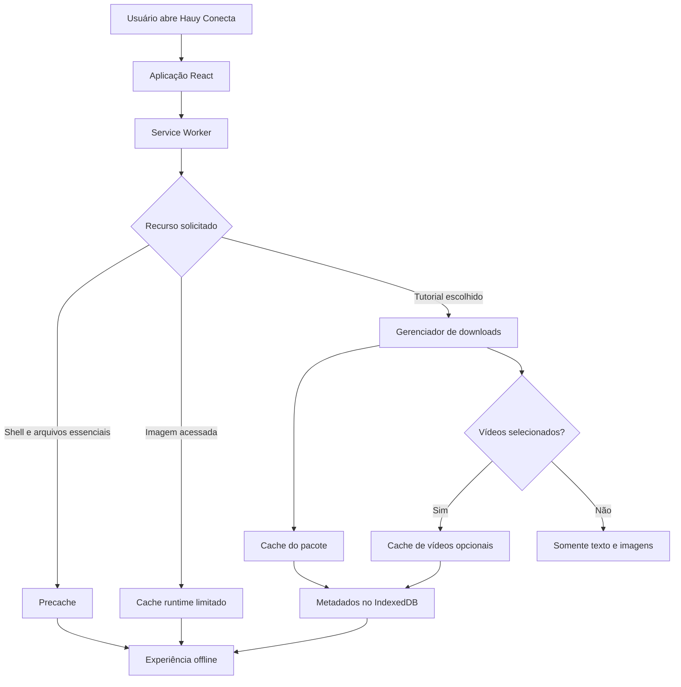

# Hauy Conecta --- Arquitetura e Planejamento do PWA

> **Status atual (31/10/2026):** núcleo do PWA implementado na branch `feat/pwa`, PR #16 aberta contra `dev`; instalação, uso offline, atualização e vídeos foram validados manualmente em Chrome desktop e dispositivos Android de teste. A validação final de preservação de pacotes entre publicações permanece reservada à URL de produção.\
> **Modelo:** híbrido — app shell e imagens acessadas em cache; tutoriais salvos sob demanda; vídeos MP4 opcionais e desmarcados por padrão.\
> **Escopo de compatibilidade:** Chrome desktop e Android testados. iOS/Safari fora do escopo de aceite desta etapa.

## 1. Objetivo e limite desta etapa

Este documento começou como arquitetura pré-implementação do Progressive Web App (PWA), registrando objetivos, opções técnicas, regras de cache e riscos. As seções iniciais preservam esse contexto e as decisões que orientaram o desenvolvimento.

**Estado revisado em 31/10/2026:** a implementação está concluída na branch `feat/pwa`. O status atual, os checklists concluídos, o aceite manual informado e as validações residuais estão nas seções 15 a 28. Qualquer mudança futura deve preservar `main` e `dev` até autorização explícita, ter testes adequados e atualizar a documentação correspondente.

Este documento continua sendo a referência técnica principal para o PWA.

## 2. Contexto atual conhecido do projeto

Com base na análise anterior do repositório:

-   React, JavaScript/JSX, Vite e Tailwind CSS.
-   React Router para navegação.
-   Tutoriais e categorias definidos em arquivos estáticos, incluindo
    `src/data/tutorials.js` e `src/data/categories.js`.
-   Componentes de mídia como `OptimizedImage` e `OptimizedVideo`.
-   `useTutorialStepMedia.js` pré-carrega mídia da etapa atual em
    memória durante a sessão; isso **não** é armazenamento offline
    persistente.
-   Pré-renderização com Astratra.
-   Build que gera metadados de imagens, rotas pré-renderizadas, build
    Vite, pré-renderização e auditoria de imagens.
-   `dist/` versionado e publicado pela automação/GitHub Actions e
    Vercel.
-   Google Analytics 4 e eventos de início/conclusão de tutoriais.
-   APIs externas para assistente e suporte.

Na auditoria executada em **30/10/2026**, na base de trabalho da branch `feat/pwa` (`691ad05`), o diretório versionado `dist/` continha **983 arquivos e 354,77 MiB**. A distribuição observada foi:

- 18 arquivos MP4: **298,38 MiB** no total; o maior possui **66,63 MiB**.
- 822 arquivos WebP: **19,08 MiB**.
- 88 arquivos PNG: **28,34 MiB**.
- 5 arquivos SVG: **6,52 MiB**.
- 26 arquivos HTML, 20 arquivos JavaScript (1,02 MiB) e 1 arquivo CSS (73,7 KiB), além de favicon, sitemap e outros arquivos pequenos.

Os 822 WebP são arquivos presentes no artefato `dist/` e incluem variantes otimizadas/geradas; não devem ser interpretados como 822 imagens-fonte únicas.

A biblioteca `public/tutoriais/` possui 158 imagens-fonte e 18 vídeos distribuídos entre os oito tutoriais. Os vídeos estão concentrados em três tutoriais: `apresentacao-canva` (14), `como-comecar-usar-excel` (2) e `salvar-google-drive` (2). O tutorial de Canva concentra a maior parte do volume de vídeo.

**Consequência:** não colocar todos os vídeos ou toda a biblioteca de
imagens no precache inicial.

## 3. Decisão principal: modelo híbrido

### Camada A --- disponibilidade básica automática

Depois de uma primeira visita online, o navegador deverá ter recursos
suficientes para:

-   Abrir o aplicativo.
-   Navegar pela estrutura principal.
-   Consultar categorias e conteúdo textual dos tutoriais incluídos no
    pacote básico.
-   Usar a busca local, desde que os dados e chunks necessários estejam
    armazenados.
-   Exibir imagens essenciais previamente selecionadas.

Não deve baixar toda a biblioteca de mídia automaticamente.

### Camada B --- downloads escolhidos pelo usuário

O usuário poderá salvar um tutorial para uso offline. O pacote deverá
incluir:

-   Recursos necessários para abrir o tutorial.
-   Imagens das etapas e exemplos.
-   Pôsteres dos vídeos, quando existirem.
-   Vídeos somente quando o usuário selecionar explicitamente essa
    opção.

A interface deverá mostrar tamanho estimado, progresso, falhas, estado
de conclusão e opção de remoção.

**Princípio central:** não consumir dados móveis nem armazenamento de
forma inesperada, principalmente com vídeos.

## 4. Arquitetura proposta

### 4.1. Responsabilidades

  -----------------------------------------------------------------------
  Componente                          Responsabilidade
  ----------------------------------- -----------------------------------
  `vite-plugin-pwa`                   Integrar PWA ao build Vite,
                                      manifesto e Service Worker

  Workbox                             Precache, roteamento, estratégias e
                                      expiração de cache

  Web App Manifest                    Nome, ícones, cores, modo de
                                      exibição e instalação

  Service Worker                      Interceptar requisições e aplicar
                                      regras offline

  Cache Storage API                   Armazenar respostas HTTP dos
                                      recursos

  IndexedDB                           Metadados, estado, versões e
                                      recursos de cada pacote

  Gerenciador de downloads React      Selecionar, baixar, acompanhar e
                                      remover tutoriais

  Storage Manager API                 Estimar uso e solicitar
                                      persistência quando disponível

  Vercel                              Servir aplicação, manifesto e
                                      Service Worker em HTTPS
  -----------------------------------------------------------------------

### 4.2. Fluxo lógico



### 4.3. Separação lógica dos caches

  -------------------------------------------------------------------------
  Cache proposto            Conteúdo                Regra
  ------------------------- ----------------------- -----------------------
  `hauy-precache`           HTML necessário, JS,    Gerenciado pelo
                            CSS e recursos          Workbox/build
                            essenciais              

  `hauy-core-images`        Logo, ícones e imagens  Precache explícito
                            pequenas essenciais     

  `hauy-runtime-images`     Imagens visualizadas    Limite de quantidade
                            durante a navegação     e/ou idade

  `hauy-tutorials`          Imagens e recursos dos  Preservar até
                            tutoriais escolhidos    remoção/atualização
                                                    controlada

  `hauy-videos`             Vídeos baixados         Controle de espaço e
                            explicitamente          remoção

  `hauy-offline-fallback`   Página/recurso de       Precache
                            fallback offline        
  -------------------------------------------------------------------------

Os nomes são identificadores propostos, não arquivos existentes. A
limpeza do cache básico **não pode apagar** pacotes escolhidos pelo
usuário.

## 5. Regras de cache por recurso

### 5.1. HTML e navegação

Estratégia proposta: tentar obter a versão atual da rede e usar fallback
armazenado quando a rede falhar.

-   Preservar as rotas do React Router.
-   Considerar as páginas HTML pré-renderizadas existentes.
-   Testar acesso direto a uma rota de tutorial sem internet.
-   Não presumir que `index.html` sozinho resolve todas as rotas.
-   Mostrar indicação discreta de modo offline.

### 5.2. JavaScript, CSS e fontes

Estratégia: precache dos arquivos gerados pelo build.

-   Incluir chunks necessários às páginas e funcionalidades básicas.
-   Incluir CSS e fontes locais essenciais.
-   Excluir vídeos e arquivos grandes.
-   Usar hashes/revisões gerados pelo Vite para invalidar arquivos
    antigos.
-   Definir `maximumFileSizeToCacheInBytes` de acordo com os arquivos
    reais.
-   Conferir o resultado do build para detectar chunks essenciais
    ausentes.

**Atenção ao lazy loading:** armazenar somente o bundle inicial não
garante que páginas carregadas sob demanda funcionem offline.

### 5.3. Dados textuais dos tutoriais

Os dados dos tutoriais são estáticos e incorporados ao bundle conforme a
arquitetura atual analisada. A leitura offline dependerá de:

-   Bundle/chunk com os dados estar armazenado.
-   Chunks carregados sob demanda estarem disponíveis.
-   Imagens necessárias estarem no cache.

Não presumir que o HTML pré-renderizado garante toda a navegação
offline. Testar abertura, mudança de etapas e carregamento de
componentes sem rede. Na Fase 0, mapear como os dados são divididos nos
chunks do build.

### 5.4. Imagens essenciais

Precache explícito de uma lista pequena e revisada:

-   Logo e ícones do aplicativo.
-   Imagens necessárias à inicialização.
-   Imagens pequenas de navegação/categorias, se consideradas
    indispensáveis.

Não incluir automaticamente todas as imagens do projeto.

### 5.5. Imagens acessadas durante o uso

Estratégia sugerida: `CacheFirst` com expiração e limite de entradas.

-   Armazenar imagens locais conforme forem acessadas.
-   Limitar quantidade e/ou idade.
-   Não deixar o cache runtime crescer indefinidamente.
-   Não misturar imagens runtime com pacotes garantidos pelo usuário.
-   Preferir URLs versionadas/hash quando disponíveis.

Uma imagem vista uma vez não deve ser tratada como garantia de que todo
o tutorial está disponível offline.

### 5.6. Vídeos

Vídeos ficam fora do precache inicial e nunca são baixados
automaticamente.

Regras:

1.  Download explícito e opcional.
2.  Mostrar tamanho estimado, quando possível.
3.  Mostrar progresso e permitir cancelar.
4.  Não marcar arquivo incompleto como disponível.
5.  Armazenar resposta completa, não fragmentos HTTP `206` isolados.
6.  Validar reprodução offline e requisições HTTP Range.

**Ponto crítico considerado na implementação:** navegadores podem solicitar partes do vídeo usando o cabeçalho `Range`. O Service Worker atual responde às requisições Range a partir do MP4 completo armazenado, com respostas 206/416. O fluxo foi coberto por E2E e por testes manuais em dispositivos reais; os detalhes atuais estão na seção 26. A condição inicial de deixar vídeos dependentes de internet foi substituída pela opção explícita e desmarcada por padrão.

### 5.7. APIs e serviços externos

Não prometer disponibilidade offline para:

-   API do assistente Gemini.
-   API de envio de dúvidas/suporte.
-   Google Apps Script/Sheets.
-   Google Analytics.
-   YouTube e outros vídeos incorporados externamente.
-   Links e serviços de terceiros.

Regras:

-   APIs em `NetworkOnly` ou tratamento de rede específico.
-   Mensagem clara quando o serviço exigir internet.
-   Não armazenar respostas potencialmente sensíveis sem necessidade e
    política explícita.
-   Não alegar envio de formulário concluído offline.
-   Analytics não pode bloquear a leitura offline.

## 6. Pacotes de tutoriais

### 6.1. Conteúdo de um pacote

Um pacote deverá identificar o tutorial e os recursos que garantem sua
consulta offline:

-   ID estável do tutorial.
-   Imagens das etapas e exemplos.
-   Pôsteres de vídeo, se necessários.
-   Vídeos apenas se selecionados.
-   Versão, data, tamanho e estado.

O texto pode já estar no bundle básico; mesmo assim, o pacote deve
registrar quais mídias foram efetivamente garantidas.

### 6.2. Estados

  Estado             Significado
  ------------------ -------------------------------------------------
  `not-downloaded`   Não salvo
  `preparing`        Recursos sendo identificados
  `downloading`      Download em andamento
  `downloaded`       Recursos obrigatórios armazenados e verificados
  `partial`          Parte dos recursos foi salva
  `error`            Falha
  `removing`         Remoção em andamento

Nunca mostrar `downloaded` se faltar um recurso obrigatório.

### 6.3. Fluxo

1.  Usuário abre tutorial.
2.  Seleciona "Salvar para uso offline".
3.  Aplicação identifica imagens e recursos necessários.
4.  Interface mostra tamanho estimado e informa se vídeos serão
    incluídos.
5.  Usuário confirma.
6.  Gerenciador baixa recursos e atualiza progresso.
7.  Ao concluir e validar, marca como disponível offline.
8.  Usuário pode remover o pacote posteriormente.

### 6.4. Vídeos como opção separada

Sugestão de experiência:

-   **Salvar tutorial:** texto, imagens e pôsteres.
-   **Incluir vídeos:** opção adicional, desmarcada por padrão.

Isso evita que um pedido de tutorial consuma dezenas de megabytes sem o
usuário perceber.

### 6.5. Falhas e integridade

O gerenciador deverá:

-   Validar status HTTP e não guardar respostas de erro como mídia
    válida.
-   Registrar recursos concluídos.
-   Permitir retomar/reiniciar quando viável.
-   Tratar recursos parciais ao cancelar ou falhar.
-   Não declarar pacote completo antes da validação.
-   Evitar operações conflitantes no mesmo tutorial.
-   Tratar falta de espaço, perda de rede e fechamento da aba.

Não prometer download em segundo plano. Navegadores podem suspender ou
encerrar a página; testar nos dispositivos-alvo.

## 7. Persistência e gerenciamento de armazenamento

### Cache Storage

Armazenar respostas HTTP de HTML, JS, CSS, imagens e vídeos. Não usar
como banco de dados do estado da interface.

### IndexedDB

Guardar metadados dos pacotes, por exemplo:

``` js
{
  tutorialId: "identificador-do-tutorial",
  status: "downloaded",
  includesVideos: false,
  resources: ["/midia/imagem-1.webp", "/midia/imagem-2.webp"],
  downloadedAt: "data-hora",
  version: "versao-do-pacote",
  totalBytes: 123456
}
```

Exemplo ilustrativo, não schema definitivo.

Campos candidatos: `tutorialId`, `status`, `includesVideos`, recursos
esperados/concluídos, data, versão, tamanho estimado/real e último erro.

**Consistência:** IndexedDB e Cache Storage são mecanismos separados.
Deve existir reconciliação para detectar metadados sem arquivos ou
arquivos sem metadados.

### Quota e persistência

-   Consultar `navigator.storage.estimate()` quando suportado.
-   Exibir estimativa de espaço, sem prometer precisão absoluta.
-   Considerar `navigator.storage.persist()` como solicitação opcional;
    o navegador decide.
-   Tratar `QuotaExceededError`.
-   Permitir remover pacotes.
-   Não presumir permanência absoluta: o navegador pode remover dados.
-   Verificar se o pacote continua íntegro quando o usuário tentar
    utilizá-lo offline.

## 8. Atualizações sem apagar downloads

### Atualização do aplicativo

Recomendação inicial: atualização com aviso (`prompt`), não recarga
automática em qualquer momento.

Fluxo:

1.  Detectar nova versão do Service Worker.
2.  Informar que há atualização.
3.  Permitir atualizar agora ou continuar usando a versão atual.
4.  Ao confirmar, ativar a versão nova e recarregar controladamente.

### Atualização dos tutoriais

-   Código do app e pacotes de tutoriais têm ciclos de vida
    independentes.
-   Alteração no tutorial deve permitir identificar pacote
    desatualizado.
-   Oferecer atualização do pacote ou preservar temporariamente versão
    anterior.
-   Não substituir pacote válido por pacote incompleto.
-   Remover versão antiga somente depois de validar a nova.
-   Atualizar precache não pode apagar caches de tutoriais/vídeos.

Usar versionamento separado para shell, conteúdo e pacotes, evitando um
único cache que apague tudo a cada build.

## 9. Integração com o build, Astratra e Vercel

O pipeline de publicação foi validado na branch feat/pwa e mantém a estratégia de artefato pré-gerado:

1. scripts de metadados de imagens e ícones;
2. geração das rotas e do sitemap;
3. build Vite com geração do manifesto e do Service Worker por injectManifest;
4. pré-renderização Astratra;
5. auditoria das imagens;
6. commit de dist/ e public/sitemap.xml na própria branch.

O workflow .github/workflows/prerender.yml executa em main e feat/pwa. Cada branch tem seu próprio grupo de concorrência. Alterações somente em dist/, public/sitemap.xml e docs/ não iniciam uma nova pré-renderização.

Depois de criar o commit do artefato, o workflow executa git reset --hard HEAD para descartar somente alterações locais não commitadas, que não fazem parte do commit de dist/. Em seguida, busca a referência remota, faz rebase do commit do artefato sobre o HEAD atualizado e envia a branch sem force push. Essa etapa evita conflitos quando a sincronização do AI_CONTEXT avança a branch enquanto a build está rodando.

A Vercel continua publicando dist/ como artefato pré-gerado. O buildCommand do vercel.json é informativo; não executa novamente Vite ou Astratra.

### Validação confirmada na preview feat/pwa

Deployment: dpl_2DWRj67dpCPR47UKxNJw77JpxPF2  
Commit publicado: 63b5bc8744da1c4ec4deabeab352846db74b56b3  
Estado: READY

| Recurso | HTTP | Content-Type |
|---|---:|---|
| / | 200 | text/html; charset=utf-8 |
| /manifest.webmanifest | 200 | application/manifest+json; charset=utf-8 |
| /sw.js | 200 | application/javascript; charset=utf-8 |
| /icons/icon-192.png | 200 | image/png |
| /icons/icon-512.png | 200 | image/png |
| /icons/icon-maskable-512.png | 200 | image/png |
| /icons/apple-touch-icon.png | 200 | image/png |

O HTML pré-renderizado da raiz contém a referência ao manifesto. O deployment foi criado pela integração Git da Vercel a partir do commit que versionou o dist/ gerado.

### Validações que estavam pendentes no primeiro deployment (registro histórico)

- Instalação pelo navegador e presença da opção de instalação.
- Abertura standalone após instalar.
- Atualização do Service Worker e comportamento do aviso de atualização.
- Reabertura e navegação offline em navegador/dispositivo-alvo.

Essa pendência referia-se ao primeiro deployment registrado acima. O aceite manual foi concluído posteriormente e está registrado nas seções 16, 20 e 24. A validação exclusiva da origem de produção continua pendente, conforme seção 16.2.

## 10. Dependências e estratégia implementadas

A integração PWA já está instalada e configurada no projeto. A stack atual é:

- `vite-plugin-pwa@2.0.0`, integrado ao Vite 8.
- Estratégia `injectManifest`, com Service Worker próprio em `src/pwa/service-worker/sw.js`.
- Workbox 7.4.1, usando os módulos necessários: `workbox-core`, `workbox-precaching` e `workbox-routing`.
- Node.js 24 nos workflows de CI e pré-renderização.
- Cache Storage para app shell, imagens runtime e pacotes individuais.
- IndexedDB nativo para metadados dos pacotes; não foi adicionada a biblioteca `idb`.

Não reinstalar essas dependências nem tratar a integração como etapa futura. Antes de alterar versões, conferir `package.json`, lockfile e compatibilidade com Vite/Node atuais.

## 11. Estratégia aplicada: `injectManifest`

A escolha por `injectManifest` está implementada porque o projeto possui regras próprias para navegação, pacotes offline, vídeos MP4, HTTP Range, atualização e limpeza de caches.

- O projeto mantém o código-fonte do Service Worker.
- O plugin injeta os arquivos do precache gerados pelo build.
- Workbox fornece precache e roteamento.
- As políticas específicas do Hauy Conecta permanecem explícitas em `sw.js` e nos módulos de domínio.

Não migrar para `generateSW` sem necessidade arquitetural demonstrável e testes de regressão.

## 12. Manifesto e instalação — estado atual

O manifesto é definido em `src/pwa/config/manifest.js` e contém nome, nome curto, descrição, idioma, ID, `start_url` e `scope` na raiz, `display: standalone`, cores e ícones PNG 192×192, 512×512 e 512×512 maskable.

O `vite-plugin-pwa` injeta `<link rel=manifest>` no HTML final. Os ícones são derivados de `public/logo.svg` por `scripts/generate-pwa-icons.mjs` antes de dev/build.

O projeto mantém metadados Apple Touch Icon no HTML, mas **iOS/Safari não faz parte do aceite desta etapa**: não temos dispositivo iOS disponível para validar a experiência e não serão adicionadas instruções ou promessas de suporte testado agora. A presença desses metadados não deve ser interpretada como validação de instalação no iOS.

A instalação nativa é oferecida pelo navegador. O CTA React personalizado de instalação foi removido por decisão do responsável; não o reintroduzir sem pedido explícito.

## 13. Interface implementada e evolução planejada

A interface atual oferece banner geral de conectividade/preparação offline/atualização e a ação `Salvar tutorial offline` na conclusão de cada tutorial. O fluxo individual oferece seleção opcional de vídeos, desmarcada por padrão, progresso, cancelamento, atualização, reparo e remoção.

**Ainda não existe uma tela central “Meus tutoriais offline”** para listar e administrar todos os pacotes em um único local. Essa melhoria está planejada, mas depende de arquitetura e priorização; consultar a seção 28.

Também não existe painel de monitoramento de quota/armazenamento baseado na Storage Manager API. O tratamento atual de quota e as estimativas de tamanho dos vídeos não equivalem a um monitoramento global do armazenamento do navegador. A proposta está na seção 28.

## 14. Pontos críticos e limitações conhecidas

1. **Build e pré-renderização:** o plugin e o Service Worker precisam continuar compatíveis com Vite, Astratra, Playwright e o artefato `dist/`.
2. **Lazy loading:** chunks necessários às rotas suportadas precisam estar disponíveis no precache ou serem recuperáveis pela política offline.
3. **Vídeos/Range:** a reprodução depende da resposta correta a HTTP Range; testes automatizados e testes manuais reportados cobriram reprodução e busca temporal offline.
4. **Quota:** o navegador pode negar armazenamento ou remover dados best-effort. O código trata `QuotaExceededError` e a suíte simula quota; uma visão global do uso e da quota ainda não foi implementada.
5. **Integridade:** IndexedDB e Cache Storage não formam uma única transação; a substituição usa cache temporário e troca de metadados após validação.
6. **Atualização:** a limpeza do app shell não pode apagar caches dos pacotes nem o cache runtime.
7. **Escopo/segurança:** não armazenar APIs, respostas sensíveis ou conteúdo de terceiros como se fossem recursos offline.
8. **Compatibilidade:** instalação e atalhos dependem também do navegador e do launcher. No Motorola E20, o Chrome não ofereceu instalação nem criação de atalho até mesmo para `https://example.com/`, inclusive após atualização do navegador; isso foi classificado como particularidade do ambiente, não falha específica do Hauy Conecta.
9. **iOS/Safari:** fora do escopo de validação e aceite desta etapa; não declarar suporte testado.
10. **Serviços externos:** Gemini, Apps Script, ferramentas externas e plataformas de vídeo continuam dependendo de internet.
11. **Downloads interrompidos:** cancelamento, perda de recursos e quota devem manter o pacote anterior íntegro ou deixar o novo pacote sem estado de concluído.

## 15. Plano de implementação por fases — estado em 31/10/2026

### Fase 0 — auditoria e decisões

- [x] Confirmar Node, Vite e dependências principais.
- [x] Inventariar `dist/`, chunks, rotas e mídia.
- [x] Definir recursos essenciais, exclusões e limite de precache.
- [x] Revisar URLs, MIME types dos artefatos PWA e publicação Vercel.
- [x] Definir matriz de validação: Chrome desktop e Android em dispositivos disponíveis.
- [x] Definir política de caches separados, quota, integridade e atualização.
- [x] Registrar iOS/Safari como fora do escopo de aceite desta etapa.

### Fase 1 — PWA instalável e app shell offline

- [x] Integrar `vite-plugin-pwa` com `injectManifest`.
- [x] Criar manifesto e geração de ícones.
- [x] Criar e registrar Service Worker.
- [x] Configurar precache e fallback de navegação.
- [x] Implementar indicador online/offline e aviso de atualização.
- [x] Criar testes unitários e E2E.
- [x] Validar build, pré-renderização, artefatos e publicação de Preview.
- [x] Validar manualmente instalação, abertura standalone, atualização e navegação offline nos ambientes desktop/Android disponíveis.

### Fase 2 — imagens runtime e pacotes de tutoriais

- [x] Cache runtime de imagens com limite de entradas.
- [x] Catálogo de recursos por tutorial.
- [x] Metadados dos pacotes em IndexedDB.
- [x] Download individual de tutorial com progresso e cancelamento.
- [x] Consulta, remoção, atualização e reparo de pacote.
- [x] Verificação de integridade e preservação do pacote anterior em falhas.
- [x] Preservar caches dos usuários durante a atualização normal do app shell.

### Fase 3 — vídeos MP4 offline

- [x] Catalogar vídeos locais e estimar tamanhos.
- [x] Permitir inclusão opcional, desmarcada por padrão.
- [x] Baixar em streaming e validar MIME/tamanho.
- [x] Implementar HTTP Range (206/416) para reprodução e busca offline.
- [x] Validar vídeos grandes em dispositivos reais, conforme aceite manual informado pelo responsável.
- [x] Cobrir falhas, cancelamento e quota simulada nos testes automatizados.

### Fase 4 — hardening, atualização e preparação de publicação

- [x] Atualização do Service Worker com confirmação explícita.
- [x] Limpeza isolada do app shell, preservando caches de usuário.
- [x] Identificação de pacotes `saved`, `outdated` e `incomplete`.
- [x] Atualização transacional, reparo e recuperação de falhas.
- [x] Testes unitários, E2E, lint, build/prerender e auditoria no GitHub Actions.
- [x] Publicar e confirmar a Preview da branch `feat/pwa`.
- [x] Aceite manual de instalação, standalone, atualização e navegação offline no Chrome desktop e Android, conforme informado pelo responsável.
- [ ] Revalidar a preservação dos pacotes entre publicações na mesma origem definitiva de produção.
- [ ] Fazer aceite manual específico de quota real/evicção de dados do navegador; a quota simulada já é coberta pelos E2E.
- [ ] Revisão final da PR e autorização para merge/publicação.

**Saída atual:** implementação funcional e validações de desenvolvimento concluídas. A etapa restante é de aceite de produção e revisão/publicação; não há necessidade de acrescentar funcionalidades ao núcleo do PWA para concluir esta entrega.

## 16. Matriz de testes e aceite

| Cenário | Resultado esperado | Situação |
|---|---|---|
| Primeiro acesso online | App shell e recursos essenciais carregados | Validado |
| Reabrir sem internet | Shell e conteúdo básico disponíveis | Validado em dispositivos Android |
| Abrir rota de tutorial diretamente offline | React Router resolve a rota usando recursos armazenados | E2E e aceite manual |
| Imagem runtime previamente acessada | Imagem servida sem rede | E2E |
| Imagem não armazenada | Ausência da mídia não quebra a página | Coberto pela estratégia/testes |
| Salvar tutorial | Recursos obrigatórios persistidos e pacote íntegro | E2E e aceite manual |
| Cancelar/falhar download | Pacote não concluído; versão anterior preservada quando existe | E2E |
| Atualizar o app | Aviso aparece e atualização depende de confirmação | E2E e aceite manual |
| Atualizar conteúdo de pacote | Novo pacote validado antes de remover o anterior | E2E |
| Armazenamento insuficiente | Erro tratado; pacote anterior preservado | Quota simulada em E2E |
| Vídeo baixado offline | Reprodução, metadados e HTTP Range funcionam | E2E e teste manual em dispositivos reais |
| Assistente/formulário offline | Não alegar que serviços externos foram executados | Limitação documentada |
| Limpar dados do site | Pacote deixa de ser declarado disponível | E2E |
| Teclado/leitor de tela | Controles e estados compreensíveis | Validar conforme alterações futuras de UI |

### 16.1 Aceite manual já informado

- **Chrome desktop:** instalação nativa, abertura standalone, atualização do Service Worker e navegação offline testadas e funcionando.
- **Samsung Galaxy A14 4G:** instalação, experiência offline e reprodução de vídeos MP4 offline testadas e funcionando.
- **Dispositivo Android TecToy:** instalação nativa testada e funcionando; os demais testes manuais realizados no ciclo foram reportados como aprovados pelo responsável.
- **Vídeos grandes:** download e reprodução offline testados em dispositivos reais e reportados como funcionando.
- **Motorola E20 (Android 11):** Chrome não apresenta opção de instalação/criação de atalho nem em `example.com/`, mesmo após atualização. É uma limitação observada do ambiente navegador/launcher e não um teste de falha do código do Hauy Conecta.
- **iOS/Safari:** não testado e fora do escopo desta entrega.

### 16.2 Validações ainda reservadas à produção

- Preservação dos pacotes entre publicações sucessivas na mesma origem de produção.
- Comportamento diante da quota real e remoção/evicção de armazenamento pelo navegador, além das simulações automatizadas.

## 17. Decisões vigentes e pendências residuais

As decisões centrais de arquitetura foram tomadas e implementadas:

1. App shell e recursos essenciais entram no precache; mídia de tutorial não é baixada automaticamente.
2. Imagens gerais são armazenadas sob demanda em cache runtime limitado.
3. Cada tutorial salvo possui cache próprio e metadados em IndexedDB.
4. O pacote normal inclui conteúdo, imagens e pôsteres; vídeos MP4 são uma seleção opcional, desmarcada por padrão.
5. A atualização do app shell não deve apagar pacotes dos usuários.
6. Atualização de pacotes usa cache temporário, validação e substituição após a gravação do novo registro.
7. Chrome desktop e Android em dispositivos disponíveis formam a matriz de aceite. iOS/Safari está fora do escopo atual.
8. O Motorola E20 apresentou indisponibilidade geral de instalação/atalhos no Chrome, inclusive em `example.com/`; não adicionar workaround no site sem evidência de que o problema seja do projeto.

Pendências que permanecem:

- Executar na origem definitiva o teste de preservação dos pacotes entre publicações.
- Fazer aceite manual de quota real e evicção/remoção de dados do navegador.
- Revisar a matriz de navegadores quando houver novos dispositivos disponíveis.

As melhorias futuras “Gerenciador central de tutoriais offline” e “Monitoramento do armazenamento” ainda não foram implementadas nem tiveram arquitetura detalhada aprovada. A proposta inicial e as questões que precisam ser resolvidas estão na seção 28.

## 18. Definição da arquitetura entregue

- [x] Conteúdo do app shell e exclusões do cache definidos.
- [x] Estratégias por tipo de recurso implementadas.
- [x] Formato e ciclo de vida dos pacotes definidos.
- [x] Limite do cache runtime definido.
- [x] Política de atualização sem apagar downloads implementada.
- [x] Integração Astratra, `dist/`, GitHub Actions e Vercel integrada.
- [x] Limitações de APIs e serviços externos documentadas.
- [x] Matriz de aceite Chrome desktop/Android documentada.
- [x] Decisão de deixar iOS/Safari fora do escopo registrada.

A arquitetura principal está fechada para esta entrega. Melhorias futuras devem ser avaliadas separadamente, reutilizando o armazenamento e os serviços existentes em vez de duplicar regras.

## 19. Referências técnicas

-   [Vite Plugin PWA ---
    documentação](https://vite-pwa-org.netlify.app/)
-   [Vite Plugin PWA --- repositório e
    instalação](https://github.com/vite-pwa/vite-plugin-pwa)
-   [Guia
    `injectManifest`](https://github.com/vite-pwa/vite-plugin-pwa/blob/main/docs/guide/inject-manifest.md)
-   [Workbox --- quota de
    armazenamento](https://developer.chrome.com/docs/workbox/understanding-storage-quota)
-   [MDN --- Web App
    Manifest](https://developer.mozilla.org/docs/Web/Manifest)
-   [MDN --- Service Worker
    API](https://developer.mozilla.org/docs/Web/API/Service_Worker_API)
-   [MDN --- Cache
    API](https://developer.mozilla.org/docs/Web/API/Cache)
-   [MDN --- IndexedDB
    API](https://developer.mozilla.org/docs/Web/API/IndexedDB_API)
-   [MDN --- StorageManager
    API](https://developer.mozilla.org/docs/Web/API/StorageManager)

## 20. Registro de escopo e situação atual

O núcleo do PWA está implementado na branch `feat/pwa`, PR #16 contra `dev`. A branch possui Preview Vercel em estado READY no HEAD consultado durante a revisão documental.

A implementação inclui app shell offline, cache runtime de imagens, pacotes individuais de tutoriais, vídeos MP4 opcionais, reprodução por HTTP Range, controle de atualização do Service Worker, integridade, reparo e preservação de pacotes durante falhas de atualização.

O responsável pelo projeto confirmou a validação manual de instalação, abertura standalone, atualização e navegação offline no Chrome desktop e em dispositivos Android disponíveis, bem como teste de vídeos grandes em dispositivos reais.

**Não confundir aceite da Preview com o aceite final de produção.** Continua reservado à publicação definitiva o teste de preservação dos pacotes entre deploys na mesma origem. A quota real/evicção do navegador também permanece como validação manual complementar.

**Estado:** núcleo técnico implementado; testes automatizados aprovados no último commit de código validado; Preview READY; aceite manual desktop/Android informado como aprovado; PR #16 continua aberta e em draft; nenhum merge autorizado.

## 21. Resultado da auditoria técnica da Fase 0

A auditoria foi realizada na branch `feat/pwa`, usando como referência o commit `691ad05260e7626d5e31efa926ee92878b197876` (30/10/2026). O resultado detalhado do inventário está registrado na seção 2.

### Divisão de código e rotas

`src/App.jsx` usa `React.lazy` para carregar sob demanda as páginas Home, Sobre, Categorias, FAQ, Tutoriais, Ferramentas, Tutorial, Enviar Dúvida e NotFound. `Category` e `Assistente` são importadas diretamente. O artefato `dist/` contém 20 arquivos JavaScript e 26 páginas HTML pré-renderizadas.

Consequência para o PWA: guardar somente o bundle inicial não garante acesso offline às páginas lazy. A política de precache deverá incluir os chunks gerados necessários às rotas suportadas, e os testes deverão abrir rotas diretamente sem conexão.

### Pipeline real de build/publicação

Na auditoria inicial, o workflow .github/workflows/prerender.yml executava somente na branch main e versionava dist/ e public/sitemap.xml. A integração da Fase 1 ampliou o gatilho para main e feat/pwa, com concorrência isolada por branch e exclusão de alterações somente documentais e de artefatos gerados.

O workflow agora executa npm run build na branch de origem, verifica o resultado com Vite/Astratra/auditoria, cria um commit para dist/ e public/sitemap.xml, limpa o working tree local e faz rebase sobre o HEAD remoto antes do push. A atualização não utiliza force push.

A Vercel publica o dist/ já gerado. A validação do deployment dpl_2DWRj67dpCPR47UKxNJw77JpxPF2 confirmou que manifesto, Service Worker e ícones chegaram à preview com HTTP 200 e MIME types corretos.

## 22. Organização modular do código e dos testes

O código específico do PWA ficará isolado em `src/pwa/`. Componentes genéricos do portal não devem receber regras de cache, IndexedDB ou Service Worker. A interface React deverá consumir serviços e hooks do módulo PWA, sem acessar diretamente os detalhes internos do Service Worker.

Estrutura planejada (as subpastas serão materializadas quando a primeira implementação de cada responsabilidade for criada; não criar diretórios vazios ou arquivos `.gitkeep`):

```text
src/pwa/
├── README.md
├── config/
│   ├── manifest.js
│   └── cache-policy.js
├── client/
│   ├── register-service-worker.js
│   ├── connection/
│   └── updates/
├── service-worker/
│   ├── sw.js
│   ├── routes/
│   └── strategies/
├── storage/
│   ├── cache/
│   └── indexed-db/
├── downloads/
│   ├── catalog/
│   ├── services/
│   └── repositories/
├── ui/
│   ├── components/
│   └── hooks/
└── utils/

tests/pwa/
├── README.md
├── unit/
├── integration/
├── e2e/
└── fixtures/

public/icons/ (será criado na fase de manifesto e ícones)
```

### Responsabilidades e limites

- `config/`: manifesto e políticas/limites centralizados, sem lógica de interface.
- `client/`: registro do Service Worker, estado de conexão e ciclo de atualização consumidos pela aplicação React.
- `service-worker/`: entrada `sw.js`, roteamento e estratégias executadas no contexto do Service Worker; não importar React nem módulos que dependam do DOM da aplicação.
- `storage/cache/`: operações de Cache Storage relacionadas a pacotes escolhidos pelo usuário.
- `storage/indexed-db/`: schema, conexão e persistência dos metadados dos pacotes; Cache Storage continua sendo o local dos corpos das respostas HTTP.
- `downloads/catalog/`: identificação dos recursos locais pertencentes a cada tutorial.
- `downloads/services/`: orquestração de download, progresso, cancelamento, integridade e remoção.
- `downloads/repositories/`: persistência e consulta dos metadados dos downloads.
- `ui/components/` e `ui/hooks/`: integração visual com React, sem duplicar regras de armazenamento.
- `utils/`: somente funções puras realmente compartilhadas; utilitários específicos devem permanecer próximos do domínio que os usa.

### Estratégia de testes

- `unit/`: regras puras, estados dos pacotes, catálogo e políticas; usar `node:test` e `node:assert`, já disponíveis no Node 24, sem instalar outro runner por antecipação.
- `integration/`: interação real entre Service Worker, Cache Storage e IndexedDB em navegador; usar Playwright, que já é dependência de desenvolvimento.
- `e2e/`: instalação/registro, atualização, abertura de rotas offline e fluxos de download/remoção.
- `fixtures/`: dados pequenos e artificiais; não copiar a biblioteca real de imagens nem vídeos pesados para os testes.

Os testes PWA deverão ter comando próprio (`npm run test:pwa`) e entrar no workflow de validação antes da conclusão da implementação. Não misturar os testes PWA com `test:search` nem renomear a atual pasta `src/test`, que contém componentes de experimentação do portal.

## 23. Registro de implementação

- Branch de trabalho: feat/pwa; main e dev permanecem intocadas.
- Dependências adicionadas como devDependencies: vite-plugin-pwa 2.0.0, workbox-core 7.4.1, workbox-precaching 7.4.1 e workbox-routing 7.4.1.
- O manifesto é definido em src/pwa/config/manifest.js.
- Os ícones são gerados de public/logo.svg pelo script scripts/generate-pwa-icons.mjs, acionado por predev e build; PNGs gerados não precisam ser versionados como fontes.
- O Service Worker usa injectManifest, nomes de cache versionados e navegação network-first com fallback ao app shell; a página estática public/offline.html é alternativa final.
- O precache inicial inclui JS, CSS, HTML, favicon, manifesto e ícones, com limite por arquivo de 2 MiB. Imagens e vídeos de tutoriais são excluídos.
- A interface apresenta estado de conexão, confirmação de preparação offline e aviso de atualização com ação explícita.
- Testes unitários e E2E foram criados e adicionados ao workflow Validate Hauy Conecta.
- npx vite build, ESLint e os quatro testes unitários passaram no sandbox Node 24. O build completo parou na etapa Astratra porque o Chromium encerra dentro do sandbox remoto; o E2E ainda deve ser confirmado no runner Ubuntu do GitHub Actions.
- Na Fase 1.1, foram adicionados cache runtime de imagens gerais e pacotes opt-in de tutoriais com Cache Storage + IndexedDB. Vídeos offline continuam fora do pacote padrão.
- Os diretórios de domínio serão criados progressivamente junto com o primeiro arquivo de cada responsabilidade para evitar scaffolding vazio.

## 24. Decisões e validação do app shell PWA

- O Service Worker é construído por `injectManifest` para manter o roteamento e a política offline sob controle do projeto.
- O registro é feito pela aplicação React por meio do módulo client; componentes não manipulam diretamente o registro do navegador.
- O tipo de atualização é prompt: a versão nova só é aplicada quando a pessoa aciona Atualizar agora.
- A navegação tenta a rede primeiro para preservar o HTML pré-renderizado e SEO. Se a rede falhar, o Service Worker devolve o app shell para o React Router tratar a rota.
- O precache é limitado por tipo de arquivo e tamanho; mídia de tutoriais não é baixada automaticamente.
- Os ícones são gerados antes de dev/build, evitando manter PNGs derivados como fontes manuais.
- O workflow Validate Hauy Conecta executa testes unitários PWA, testes existentes, ESLint, build/prerender/auditoria e testes E2E no runner Ubuntu.
- O CI confirmou registro/ativação do Service Worker e navegação offline para uma rota de tutorial.
- O deployment Vercel da Preview confirmou manifesto, Service Worker e ícones com HTTP 200 e MIME types corretos.

**Aceite manual informado pelo responsável:** instalação nativa e abertura standalone no Chrome desktop e Android, atualização do Service Worker e navegação offline foram testadas e estão funcionando. Os testes de vídeos grandes e reprodução offline em dispositivos reais também foram concluídos com sucesso.

A opção de instalação personalizada na Home foi removida. A instalação permanece sob controle da interface nativa do navegador; não adicionar CTA de instalação sem nova solicitação.

## 25. Fase 1.1 — imagens runtime e pacotes individuais de tutoriais

Esta seção registra a implementação que ampliou o app shell com cache runtime de imagens e downloads opt-in de tutoriais.

### Imagens gerais e identidade visual

- `logo.svg`, `iloveIMG.svg`, `ilovePDF.svg`, favicon e ícones PWA entram no precache.
- O Service Worker aplica cache runtime às solicitações de imagem da mesma origem.
- Imagens de seções, fotos da equipe, imagens de conteúdo e variantes geradas em `/_optimized/` são armazenadas quando solicitadas.
- O cache runtime possui limite de 1.000 entradas e namespace independente.
- Recursos que nunca foram solicitados enquanto havia conexão não são baixados antecipadamente. A disponibilidade offline depende de a imagem já ter sido armazenada.

### Salvar um tutorial para uso offline

O botão `Salvar tutorial offline` aparece no componente de conclusão do tutorial, depois do último passo.

O pacote base coleta imagens, pôsteres e variantes responsivas de cada imagem, incluindo as variantes registradas em `src/generated/imageMetadata.json`. Os dados textuais do tutorial já estão nos bundles pré-cacheados.

Cada pacote possui cache próprio no Cache Storage. Os metadados e a lista de recursos esperados ficam no IndexedDB `hauy-conecta-offline`. O download tem concorrência limitada, progresso, cancelamento, validação de respostas, remoção de cache parcial em caso de falha e ação para atualizar/remover o pacote.

**Vídeos MP4 não entram no pacote base por padrão.** A interface oferece uma seleção separada e desmarcada inicialmente para incluir os MP4 locais; esse fluxo e suas validações estão descritos na seção 26.

A disponibilidade é local ao navegador/dispositivo. Não existe sincronização entre dispositivos nem uma tela central para gerenciar todos os pacotes.

### Arquivos e testes relacionados

- `src/pwa/config/cache-policy.js`: versões, logos de precache, limite do cache runtime e prefixo dos pacotes.
- `src/pwa/service-worker/sw.js`: roteamento de imagens e prioridade de caches de pacotes.
- `src/pwa/downloads/tutorial-package.js`: coleta de recursos, Cache Storage e IndexedDB.
- `src/pwa/ui/components/TutorialOfflineButton.jsx`: salvar, progresso, cancelamento, atualização, reparo e remoção.
- `tests/pwa/unit/tutorial-package.test.js`: catálogo, variantes responsivas e regras do pacote.
- `tests/pwa/e2e/offline-navigation.test.js`: navegação offline, armazenamento runtime e fluxos de pacote.

## 26. Fase 3 — vídeos MP4 offline

A opção de incluir vídeos é separada e vem desmarcada por padrão. O pacote normal continua incluindo texto, imagens, pôsteres e variantes responsivas.

### Catálogo e estimativa

- `scripts/generate-image-metadata.mjs` cataloga os MP4 de `public/tutoriais/`, registrando tamanho em bytes.
- `collectTutorialVideoResources` identifica MP4 locais nos passos e exemplos, elimina duplicatas e ignora URLs externas.
- `estimateTutorialVideoSize` agrega tamanhos conhecidos para exibir quantidade e estimativa antes do download.
- O catálogo registrado nesta revisão contém 18 MP4 locais, com aproximadamente 298,38 MiB somados. Não há download automático.

### Download e armazenamento

- A opção “Incluir vídeos para assistir sem internet” é opcional e desmarcada por padrão.
- Os vídeos selecionados são baixados integralmente para o cache isolado do tutorial.
- O download valida HTTP 200, MIME type compatível e, quando disponível, tamanho esperado.
- O corpo é encaminhado em streaming ao Cache Storage.
- O progresso informa arquivos e bytes transferidos. Cancelamento/falha remove o cache temporário; o pacote anterior só é removido depois que o novo foi persistido e validado.
- Os metadados registram URLs de imagens e vídeos separadamente.

### Reprodução offline e HTTP Range

- Uma requisição sem Range recebe a resposta completa armazenada.
- Uma requisição `Range: bytes=início-fim` recebe HTTP 206 com `Content-Range`, `Content-Length` e `Accept-Ranges`.
- Intervalos inválidos ou fora do tamanho recebem HTTP 416.
- MP4 não incluído no pacote e videoaulas externas continuam dependendo da rede.

### Testes e aceite

- Testes unitários cobrem coleta/deduplicação de MP4, exclusão de URLs externas, estimativa de bytes e formatação.
- O E2E valida o MP4 no Cache Storage, metadados do player e busca temporal offline com HTTP 206.
- **O responsável pelo projeto confirmou que vídeos grandes foram testados em dispositivos reais e que o download/reprodução offline está funcionando.** Isso complementa o E2E com arquivos pequenos.
- Quota simulada, cancelamento e falhas de recursos são cobertos pelos testes automatizados. A quota real do navegador e a evicção continuam como validação complementar pendente.

## 27. Fase 4 — atualização de conteúdo e recuperação de pacotes offline

A implementação fortalece a confiabilidade dos pacotes opt-in sem misturar o ciclo de vida do app shell, do cache runtime de imagens e dos caches individuais dos tutoriais.

### 27.1 Atualização do Service Worker

- O registro permanece no modo `prompt`: a nova versão não é aplicada silenciosamente.
- A ativação limpa apenas caches antigos do app shell, por meio de `src/pwa/service-worker/cache-cleanup.js`.
- A limpeza usa `Promise.allSettled`; falhas ao remover caches antigos não impedem a ativação.
- Os caches `hauy-conecta-tutorial-package-*` e `hauy-conecta-runtime-images-v1` ficam fora da política de limpeza do app shell.

### 27.2 Identificação de conteúdo desatualizado

O IndexedDB registra fingerprints separadas:
- `contentVersion`: dados do tutorial, passos, imagens e metadados das imagens;
- `videoContentVersion`: lista e metadados dos MP4 opcionais.

O script de metadados gera tamanho e SHA-256 para imagens e vídeos. Os estados apresentados pela consulta são `saved`, `outdated`, `incomplete` e `null`, conforme a integridade e a versão do conteúdo.

### 27.3 Integridade e atualização transacional

Durante o download, respostas precisam ser HTTP 200 e possuir MIME type compatível. Os corpos são encaminhados em streaming ao Cache Storage; o tamanho recebido é registrado em `resourceDetails`. Recursos vazios ou inválidos provocam falha e descarte do cache temporário.

A consulta verifica existência, status, corpo, MIME type e tamanho registrado. A validação não recalcula SHA-256 do corpo armazenado em cada abertura: os hashes do build identificam mudanças no conteúdo publicado, enquanto a consulta local verifica a resposta persistida.

A substituição ocorre em duas etapas: (1) criar cache temporário e baixar/validar os recursos; (2) gravar o novo registro no IndexedDB e somente então remover o cache anterior.

Se o download for cancelado, um recurso ficar indisponível, o Cache Storage falhar ou a quota for excedida, o cache temporário é descartado e o pacote anterior permanece associado ao registro antigo. Pacotes `incomplete` podem ser reparados; pacotes `outdated` podem ser atualizados.

### 27.4 Testes e validação atual

- Unitários: fingerprints, mudanças em texto/imagens/vídeos, separação da versão dos vídeos opcionais e validação de recursos.
- Service Worker: limpeza de caches antigos do app shell sem apagar runtime images ou pacotes.
- E2E: reparo de cache ausente, atualização de conteúdo, preservação do pacote anterior, limpeza de dados locais, quota simulada, resposta inválida, cancelamento e arquivo indisponível.
- O workflow **Validate Hauy Conecta**, run `41242399960`, concluiu com sucesso no último commit de código validado (`7b901b8`). O build/prerender também concluiu com sucesso no workflow `41242394976`.
- O deployment correspondente ao HEAD consultado (`9161dd0`) está READY na Preview da Vercel.
- O responsável confirmou atualização do Service Worker e uso offline nos dispositivos de teste.

Permanecem fora da validação de Preview: preservar pacotes entre publicações sucessivas na mesma origem definitiva de produção e observar quota real/evicção do navegador.

## 28. Melhorias futuras — ainda não implementadas

As duas melhorias abaixo foram identificadas como evoluções úteis, mas **não fazem parte da entrega atual**. Antes de implementar, devem ser transformadas em histórias pequenas, com regras de produto, fluxos, estados, testes e decisão de UX documentados.

### 28.1 Gerenciador central de tutoriais offline

**Objetivo:** oferecer uma área “Meus tutoriais offline” para a pessoa visualizar e administrar os tutoriais salvos sem precisar abrir cada tutorial individualmente.

**Base técnica existente a reutilizar:**
- IndexedDB `hauy-conecta-offline`, object store `tutorial-packages`, como índice dos pacotes salvos.
- Cache Storage, usando o `cacheName` registrado, como fonte dos recursos persistidos.
- `getTutorialOfflinePackage` para verificar integridade e classificar `saved`, `outdated` ou `incomplete`.
- `saveTutorialOffline` e `removeTutorialOffline` para executar operações existentes; a nova tela não deve duplicar lógica de download, integridade ou remoção.
- Catálogo atual de tutoriais em `src/data/tutorials.js` para resolver título, categoria e rota, considerando registros órfãos caso o tutorial tenha sido removido da biblioteca.

**Proposta inicial de experiência:**
- lista de pacotes com título, categoria e data de salvamento;
- indicação se o pacote contém vídeos;
- estado atualizado, desatualizado ou incompleto;
- ações de abrir tutorial, atualizar/reparar e remover;
- estado vazio, carregamento, erro de leitura e confirmação antes de remover;
- resumo da quantidade de pacotes salvos.

**Decisões de arquitetura a fechar antes do código:**
1. Onde a pessoa acessará a área: rota própria, item de navegação ou entrada em Tutoriais?
2. Como listar todos os registros do IndexedDB sem expor a API de baixo nível aos componentes?
3. Como calcular e exibir tamanho por pacote? O registro já possui `resourceDetails[].size` e `totalVideoBytes`; definir agregação consistente sem varrer todos os corpos a cada renderização.
4. Como atualizar o estado quando outra aba salva/remove um pacote?
5. Como tratar registros órfãos e pacotes parcialmente corrompidos?
6. A remoção será individual inicialmente; ações em massa exigem decisão de UX e confirmação.

### 28.2 Monitoramento do armazenamento

**Objetivo:** dar visibilidade aproximada ao espaço utilizado pelo Hauy Conecta e ao limite informado pelo navegador, ajudando a pessoa a decidir se deve remover pacotes ou evitar baixar vídeos grandes.

**APIs candidatas:**
- `navigator.storage.estimate()`: fornece estimativa de uso e quota para a origem. Os números são aproximados, variam por navegador e incluem dados da origem que não são exclusivamente os pacotes de tutorial.
- `navigator.storage.persisted()`: informa se o armazenamento da origem está marcado como persistente, quando suportado.
- `navigator.storage.persist()`: pode solicitar persistência ao navegador; não garante concessão e não deve ser chamado automaticamente sem uma decisão de UX.

**Proposta inicial de experiência:**
- mostrar uso aproximado e quota quando a API estiver disponível;
- indicar claramente quando o navegador não oferece a API;
- explicar que a quota é compartilhada pela origem e que o navegador pode não revelar detalhes;
- oferecer acesso ao gerenciador de tutoriais para liberar espaço;
- manter o tratamento de `QuotaExceededError` mesmo que a estimativa indique espaço disponível, pois a quota pode mudar entre consulta e gravação.

**Decisões de arquitetura a fechar antes do código:**
1. Onde o resumo de armazenamento aparece: no futuro gerenciador central, nas configurações ou em ambos?
2. A atualização será sob demanda, ao entrar na tela ou após downloads/remoções? Evitar polling contínuo.
3. Como apresentar `usage`, `quota` e `usageDetails` sem sugerir precisão que a API não oferece?
4. Como tratar APIs ausentes, valores nulos, erros e permissões de persistência negadas?
5. Solicitar `persist()` somente após explicar o benefício e com ação explícita da pessoa, se a política do navegador permitir.
6. A estimativa global não substitui tamanho dos pacotes, nem garante que um download cabe.

**Ordem recomendada:** arquitetar primeiro o contrato de leitura/listagem de pacotes para o gerenciador; em seguida decidir como integrar a estimativa global de armazenamento nessa mesma área. Implementar e testar as duas melhorias separadamente, sem alterar o fluxo de download já validado.
